# Arquitectura de JARVIS Core

> Última revisión: **2026-10-13** (v1.3 — Motor Unificado, Decision 2.0 Eos, Qwen 3.5 9B y Coordinación PLAN)

JARVIS Core implementa una arquitectura full-stack desacoplada: el backend en Node.js (`server.ts` y `src/core/core.ts`) actúa como autoridad de ejecución orquestando los modos FAST y PLAN, mientras que la interfaz en React 19/Vite 8 (`src/App.tsx`) opera como cliente reactivo mediante HTTP y Server-Sent Events (SSE). 

El orquestador unifica la ejecución atómica de pasos a través de `runStep` (`src/core/callExecutor.ts`), integrando modelos probabilísticos especializados (**Decision 2.0 / Eos-0.8B** para enrutamiento estructural, selección de herramientas y verificación factual binaria `ok`/`cumple` por argmax; **Qwen 3.5 9B** para generación de argumentos con JSON schema estricto, planificación estructurada, verificación semántica de etapas y síntesis de respuesta final) con compuertas deterministas (**Guard** para control de políticas y seguridad, **RefResolver** para sustitución de referencias temporales `{{ref:rX}}`, **ResultProcessor** para extracción de hechos/señales y **Anti-Loop** por firma binaria) y servidores locales MCP (**Windows MCP**, **Desktop Commander** y **Free Search**) por transporte `stdio`, además de herramientas locales (`recall`, `compose`, `ask_user`).

---

## Diagrama General de Arquitectura (v1.3)

```mermaid
flowchart TD
    subgraph UI ["Capa de Presentación (React 19 / Vite 8)"]
        Browser["Usuario / Operador"]
        App["App.tsx / useJarvis"]
        TopBar["TopBar & ModeSelector"]
        CommandSec["CommandSection & PromptInput"]
        GuardUI["GuardBanner & ApprovalAction (WAITING_INPUT sin timeout)"]
        FlowUI["ProcessFlow, PlanReview & StepTimeline"]
        ContextUI["ContextInspector (MemoryView, RefStore Inspector, Catalog)"]
        DecUI["DecisionStream & DecisionVerificationView (ok / cumple)"]
    end

    subgraph Host ["Host Autoritativo (Node.js Express - server.ts)"]
        RouterJarvis["/api/jarvis/* (Process, Cancel, Confirm, Reject, Modify, UserAnswer, Ref)"]
        RouterSSE["/api/jarvis/events (Server-Sent Events)"]
        RouterMCP["/api/mcp/* (Direct Calls, Tools & Reconnect)"]
    end

    subgraph CoreEngine ["Núcleo Orquestador (JarvisCore - src/core/core.ts)"]
        Core["JarvisCore"]
        ModeFast["FAST Mode (runFastLoop - Ejecución Continua)"]
        ModePlan["PLAN Mode (runPlanLoop - Supervisión & Coordinación)"]
        CallExec["Motor Unificado runStep (src/core/callExecutor.ts)"]
        CtxMgr["Context & Memory Helpers (context.ts - LOG, Facts, Effects, Handoff)"]
    end

    subgraph Reasoning ["Modelos & Razonamiento"]
        D2Engine["Decision20Engine (decision.ts)"]
        D2Service[("Decision 2.0 HTTP /v1/decide (Eos-0.8B)")]
        QwenEng["QwenEngine (qwen.ts)"]
        OllamaService[("Qwen 3.5 9B HTTP /v1/chat/completions")]
        PromptCentral["Prompts Centralizados (prompts.ts)"]
    end

    subgraph Security ["Seguridad & Políticas"]
        Guard["Guard (guard.ts)"]
        PolicyReg["PolicyRegistry (policyRegistry.ts)"]
        Manifest["Manifest Tipado (manifest.ts - 61 tools)"]
        RefResolver["RefResolver (refResolver.ts - {{ref:rX}})"]
    end

    subgraph MCPBridge ["Capa MCP & Descubrimiento"]
        DiscEng["DiscoveryEngine (discovery.ts)"]
        Transport["StdioMcpTransport (transport.ts)"]
        WinServer["WindowsMCPServer (windows-mcp - 21 tools)"]
        DeskServer["DesktopCommanderMCPServer (desktop-commander - 26 tools)"]
        SearchServer["FreeSearchMCPServer (free-search-mcp - 11 tools)"]
        LocalTools["Herramientas Locales (recall, compose, ask_user)"]
    end

    subgraph DataStorage ["Persistencia & Aislamiento"]
        ResultProc["ResultProcessor (resultProcessor.ts)"]
        RefStore[("RefStore (Memoria volátil aislada por taskId)")]
        TaskFile[("jarvis-tasks.json (Disco)")]
        ConfigFile[("jarvis-config.json (Disco)")]
    end

    %% Relaciones de comunicación
    Browser --> App
    App --> RouterJarvis
    App --> RouterSSE
    RouterJarvis --> Core
    
    Core --> ModeFast
    Core --> ModePlan
    ModePlan -.->|Entrega etapas| CallExec
    ModeFast --> CallExec
    
    CallExec --> D2Engine
    CallExec --> QwenEng
    CallExec --> RefResolver
    RefResolver --> RefStore
    CallExec --> Guard
    Guard --> PolicyReg
    PolicyReg --> Manifest
    Guard -.->|APPROVAL| GuardUI
    
    D2Engine --> D2Service
    QwenEng --> OllamaService
    D2Engine & QwenEng -.-> PromptCentral
    
    CallExec --> DiscEng
    DiscEng --> WinServer & DeskServer & SearchServer & LocalTools
    WinServer & DeskServer & SearchServer --> Transport
    
    CallExec --> ResultProc
    ResultProc --> RefStore
    ResultProc --> CtxMgr
    Core --> TaskFile
    Core --> ConfigFile
```



---

## Verificación de Dependencias Modulares

La integridad de las dependencias modulares se comprueba de forma determinista mediante `madge`:

```bash
# Detectar dependencias circulares (verificado: 0 dependencias circulares)
npx madge --extensions ts,tsx --ts-config tsconfig.json --circular src/
```

> **Verificación comprobada:** El análisis sobre 53 archivos del código fuente concluye exitosamente: `✔ No circular dependency found!`.

---

## Componentes y Responsabilidades

| Componente | Responsabilidad | Ruta |
|------------|----------------|------|
| **Host HTTP & API** | Expone endpoints REST (`/api/jarvis/*`, `/api/mcp/*`), canal reactivo SSE (`/api/jarvis/events`) y gestiona el ciclo de vida ordenado con `SIGINT`/`SIGTERM`. | `server.ts` |
| **Orquestador Central (`JarvisCore`)** | Coordina el ciclo de vida de tareas, aislamiento por `taskId`, concurrencia, invarianza de estados terminales, persistencia en `jarvis-tasks.json` y despacho de eventos reactivos. | `src/core/core.ts` |
| **Coordinación de Modos (`ModeEngines`)** | `runFastLoop`: orquesta iteraciones de pasos, escalación y parada en `MAX_STEPS = 15`. `initiatePlanMode` / `runPlanLoop`: coordina planificación, suspensión en `WAITING_INPUT`, supervisión de etapas, verificación con Qwen (`verifyStage`) y replanificación acotada (`handleReplan`, `MAX_REPLAN = 2`). | `src/core/modeEngines.ts` |
| **Motor Unificado de Paso (`runStep`)** | Ciclo canónico atómico: selección en Eos, generación de argumentos con Qwen, sustitución de referencias temporales con `RefResolver`, verificación Anti-Loop por firma, evaluación en Guard, despacho MCP, procesamiento de resultados y verificación factual Eos (`ok` / `cumple`). | `src/core/callExecutor.ts` |
| **Motor de Decisión (`Decision20Engine`)** | Cliente HTTP para Decision 2.0 (Eos-0.8B). Resuelve Decision #1 (enrutamiento estructural), Decision #2 (selección de tool) y verificación binaria `ok` / `cumple` por mayor probabilidad (argmax) sin umbrales arbitrarios. | `src/core/decision.ts` |
| **Razonador LLM (`QwenEngine`)** | Cliente HTTP para Qwen 3.5 9B. Genera argumentos conformes a JSON schema limpio, planes estructurados, replanificación localizada, verificación semántica de etapas (`verifyStage`), redacción con `compose` y respuesta final. | `src/core/reasoner/qwen.ts` |
| **Prompts Centralizados (`Prompts`)** | Centraliza plantillas de sistema y constructores de prompts para Qwen y Decision 2.0 con sanitización estricta (`safe()`) y ordenamiento optimizado para la caché KV de Ollama. | `src/core/reasoner/prompts.ts` |
| **Compuerta de Seguridad (`Guard`)** | Evalúa si una llamada está permitida (`ALLOW`), bloqueada incondicionalmente (`DENY`) o requiere autorización humana (`APPROVAL`). Inspecciona argumentos reales y decodificados tras la sustitución de referencias. | `src/core/policy/guard.ts` |
| **Registro de Políticas (`PolicyRegistry`)** | Mapeo determinista poblado desde `SYSTEM_TOOL_MANIFEST`, asociando pares (servidor MCP, herramienta) a capacidades y tipos de acción (`READ` vs `no-READ`). | `src/core/policy/policyRegistry.ts` |
| **Manifiesto Tipado de Herramientas** | Fuente única de verdad tipada (`SYSTEM_TOOL_MANIFEST`) para las 61 herramientas del sistema (21 Windows + 26 Desktop Commander + 11 Free Search + 3 Locales) y constructor de catálogo compacto `buildCompactCatalog`. | `src/core/tools/manifest.ts` |
| **Resolutor de Referencias (`RefResolver`)** | Sustituye de forma determinista y recursiva tokens temporales `{{ref:rX}}` o `{{rX}}` por contenidos reales de `RefStore` antes de la inspección de Guard y despacho físico. | `src/core/processor/refResolver.ts` |
| **Procesador de Resultados (`ResultProcessor`)** | Extrae hallazgos compactos (`finding`), señales de ejecución físicas (`exit_code`, `timeout`, `not_found`, etc.), deltas de hechos/scratchpad y alimenta `RefStore`. | `src/core/processor/resultProcessor.ts` |
| **Almacén de Referencias (`RefStore`)** | Almacén en memoria de salidas completas de herramientas indexadas por clave `rX`, aislado estrictamente por `taskId`. Consultable vía `/api/jarvis/ref/:refKey`. | `src/core/processor/resultProcessor.ts` |
| **Motor de Descubrimiento (`DiscoveryEngine`)** | Descubre dinámicamente herramientas (`tools/list`), plantillas de recursos y prompts de servidores MCP; limpia esquemas de entrada (`cleanInputSchema`) y cachea resultados. | `src/core/mcp/discovery.ts` |
| **Transporte MCP (`StdioMcpTransport`)** | Gestiona procesos hijos persistentes por stdio con protocolo JSON-RPC 2.0, enmarcado de líneas, control de timeouts y terminación de árboles de procesos. | `src/core/mcp/transport.ts` |
| **Adaptadores MCP (`Windows`, `Desktop`, `Search`)** | Encapsulan la comunicación stdio con `windows-mcp`, `@wonderwhy-er/desktop-commander` y `free-search-mcp`. | `src/core/mcp/windowsMcp.ts`, `src/core/mcp/desktopCommanderMcp.ts`, `src/core/mcp/freeSearchMcp.ts` |
| **Gestor de Configuración (`ConfigManager`)** | Administra y persiste las opciones en `jarvis-config.json` con recarga dinámica y validación de tipos. | `src/core/config.ts` |
| **Contexto y Memoria (`Context Helpers`)** | Administra `TaskExecutionContext`, LOG continuo de hasta 30 líneas completas (sin colapso a `1-N`), cola FAIL, hechos FACTS, efectos confirmados `effects`, handoff determinista y memoria progresiva (2→5→10). | `src/core/context.ts` |
| **Cliente Web React (`App` y Hooks)** | Interfaz reactiva con sincronización en tiempo real vía SSE, visualización de veredictos Eos, inspección de memoria/RefStore, y ciclo interactivo de PLAN. | `src/App.tsx`, `src/hooks/useJarvis.ts`, `src/components/*` |

---

## Dependencias entre Módulos

```
server.ts ──► JarvisCore ──► ModeEngines (FAST / PLAN) ──► runStep
                                                            │
    ┌───────────────────┬───────────────────┬───────────────┴───────────────┬───────────────────┐
    ▼                   ▼                   ▼                               ▼                   ▼
Decision20Engine    QwenEngine         RefResolver                        Guard           DiscoveryEngine
(Eos HTTP)         (Ollama HTTP)            │                               │                   │
                                            ▼                               ▼                   ▼
                                         RefStore                    PolicyRegistry      Transportes MCP
                                                                            │             (stdio JSON-RPC)
                                                                            ▼
                                                                  SYSTEM_TOOL_MANIFEST
```

| Módulo | Depende de | No debe depender de |
|--------|-----------|---------------------|
| `src/core/core.ts` | `decision`, `discovery`, `qwen`, `context`, `callExecutor`, `resultProcessor`, `modeEngines`, `types` | UI (`src/components/`, `src/hooks/`) |
| `src/core/modeEngines.ts` | `context`, `callExecutor`, `resultProcessor`, `qwen`, `decision`, `types` | UI, servidores Express |
| `src/core/callExecutor.ts` | `decision`, `discovery`, `guard`, `policyRegistry`, `qwen`, `resultProcessor`, `refResolver`, `context`, `types` | UI, `core.ts` directamente |
| `src/core/decision.ts` | `config`, `prompts`, `types` | `core.ts`, transportes MCP, UI |
| `src/core/reasoner/qwen.ts` | `config`, `prompts`, `discovery`, `types` | `core.ts`, UI, transportes MCP |
| `src/core/policy/guard.ts` | `policyRegistry`, `types` | Modelos LLM (`qwen.ts`, `decision.ts`), ejecutores, UI |
| `src/core/policy/policyRegistry.ts` | `tools/manifest.ts`, `types` | Modelos LLM, ejecutores, UI |
| `src/core/tools/manifest.ts` | `types` | Ningún otro módulo (fuente única de verdad tipada) |
| `src/core/processor/refResolver.ts` | `resultProcessor.ts` (`RefStore`) | Modelos LLM, transportes MCP, UI |
| `src/core/processor/resultProcessor.ts` | `policyRegistry`, `types` | `callExecutor.ts`, `core.ts`, UI |
| `src/core/mcp/discovery.ts` | `mcp/types`, `types`, `tools/manifest.ts` | `core.ts`, UI |
| `src/core/mcp/transport.ts` | `config`, `mcp/types`, `types`, `node:child_process` | Modelos LLM, `core.ts`, UI |
| `src/hooks/useJarvis.ts` & `services` | `types`, `mcp/types`, `utils/apiUrl` | `core.ts`, `node:child_process`, `node:fs` (ámbito de navegador) |
| `server.ts` | Módulos backend de `src/core/`, `express`, `dotenv`, `node:fs`, `node:path` | Componentes React de UI |

---

## Modelo y Parámetros Operativos

| Parámetro | Valor Oficial v1.3 | Justificación / Fuente |
|---|---|---|
| **Modelo Principal (LLM)** | `qwen3.5:9b` | Configurable en `jarvis-config.json:qwenModel`. |
| **Endpoint LLM** | `http://127.0.0.1:11434/v1/chat/completions` | Configurable en `jarvis-config.json:qwenUrl`. |
| **Temperatura (Qwen)** | `0.1` | Fijada en `dispatchPrompt` para generación determinista de parámetros y planes. |
| **Ventana de Contexto (Qwen)** | `8192` tokens | `QWEN_CTX = 8192`, parámetro `num_ctx`. |
| **Máx. Tokens de Salida (Qwen)** | Args: `1024` · Final: `1500` (`1000` en fallback) · PLAN: `1500` | Configurado por etapa de generación. |
| **Thinking Mode (Qwen)** | `false` para generación de argumentos (`thinking: false`); dinámico en PLAN/Respuesta Final según ajuste de usuario | `generateArguments` fuerza `thinking: false` para baja latencia. |
| **Timeout (Qwen)** | `120000 ms` (120 s; ampliado a ≥ 180 s con `thinking: true`) | `qwenTimeoutMs` en `jarvis-config.json`. |
| **Modelo Clasificador** | `Decision-2.0-Eos-0.8B` | Modelo de decisiones estructuradas. |
| **Endpoint Clasificador** | `http://127.0.0.1:8765/v1/decide` | Configurable en `jarvis-config.json:decisionUrl`. |
| **Ventana de Contexto (Eos)** | `8192` tokens | Presupuesto operativo de runtime. |
| **Resolución de Decisiones Eos** | **Mayor Probabilidad (Argmax)** sin umbrales numéricos de corte | D1, D2 y verificación `ok`/`cumple` ($p \ge 0.5$) se resuelven por argmax sin filtros fijos de 0.51 o 0.60. |
| **Verificación Factual de Paso** | Consulta binaria `ok` y `cumple` sobre señales limpias (CLEAN) | Evaluada en `runStep` con Eos. Si hay errores físicos, se gestiona determinísticamente sin consultar al modelo. |
| **Límite Estructural de Pasos** | `MAX_STEPS = 15` | Límite de referencia unificado en FAST y PLAN. |
| **Límite de Replanificaciones** | `MAX_REPLAN = 2` | Máximo de replanes acotados permitidos en PLAN. |
| **Límite de Reintentos de Args** | `MAX_ARG_RETRIES = 2` | Reintentos locales ante fallos de validación de JSON schema. |
| **Límite de Escalaciones** | `MAX_ESCALATIONS = 2` | Máximo de conmutaciones de ruta en modo FAST. |
| **Memoria Contextual Progresiva** | `2 → 5 → 10` elementos relevantes | Nivel 1 inicial (2); ampliado a 5 ante `needsContext`; techo en 10. |
| **Límites Globales de Llamadas** | **ERRADICADOS TOTALMENTE** | Eliminados `MAX_TOOL_CALLS_TASK = 30` y `MAX_TOOL_CALLS_PER_STEP = 4`. Sin pools artificiales sustitutos. |
| **Deadline Global de Tiempo** | **NO IMPLEMENTADO** | Tareas no expiran por tiempo total de reloj; solo aplican timeouts técnicos por invocación. |

---

## Decisiones Fundamentales de Diseño

1. **FAST como Motor de Ejecución y PLAN como Capa de Coordinación:**
   - FAST ejecuta cada paso atómicamente a través de `runStep`.
   - PLAN no implementa una lógica paralela ni mini-bucles de llamadas; genera el plan con Qwen, obtiene la confirmación humana en `WAITING_INPUT`, entrega cada etapa a `runStep`, verifica semánticamente con `verifyStage` y replanifica de forma acotada ante desviaciones recuperables.
2. **Sustitución Factual de Referencias antes de Guard:**
   - Ninguna herramienta recibe tokens sintéticos sin resolver. `RefResolver` deserializa e inyecta los datos reales de `RefStore` en los argumentos antes de que `Guard` los evalúe, imposibilitando que comandos o rutas destructivas eludan la seguridad.
3. **Inviolabilidad Absoluta de Guard DENY:**
   - Una denegación de Guard o un rechazo del operador jamás se reintenta ni se conmuta para evadir la seguridad. En FAST detiene la tarea inmediatamente; en PLAN concluye la tarea sin invocar `handleReplan`.
4. **Suspensión en `WAITING_INPUT` sin Temporizadores:**
   - Las esperas para aprobación de Guard (`approval`), confirmación de plan (`plan_confirmation`) o aclaraciones del operador (`user_answer`) no tienen cronómetros de expiración. La tarea permanece suspendida de forma indefinida hasta la acción voluntaria del usuario.
5. **Memoria Factual Continua:**
   - Se suprimió el colapso estadístico prematuro `1-N`. El sistema conserva el historial continuo detallado (`log`) de hasta 30 entradas, hechos estructurados (`facts`), efectos confirmados (`effects`) y handoffs deterministas entre etapas.
6. **Invarianza de Estados Terminales:**
   - Un estado terminal (`COMPLETED`, `PARTIAL`, `FAILED`, `CANCELLED`) es inmutable. Si una tarea es cancelada, cualquier resultado tardío de inferencia o proceso stdio en vuelo es descartado en silencio sin sobreescribir el estado.

---

## Archivos Relacionados

| Archivo | Rol en el Sistema |
|---|---|
| `server.ts` | Host Node.js full-stack, enrutadores Express, Server-Sent Events y ciclo de vida de procesos. |
| `src/core/core.ts` | Orquestador principal `JarvisCore`, iniciación de tareas, persistencia y eventos reactivos. |
| `src/core/types.ts` | Contratos tipados, interfaces, estados de tareas/pasos y límites del sistema. |
| `src/core/modeEngines.ts` | Coordinación de FAST (`runFastLoop`), PLAN (`runPlanLoop`), verificación de etapa y replanificación. |
| `src/core/callExecutor.ts` | Motor unificado de paso `runStep`: selección, argumentos, anti-loop, Guard, despacho y verificación. |
| `src/core/decision.ts` | Cliente HTTP de Decision 2.0 (Eos-0.8B) con resolución por mayor probabilidad (argmax). |
| `src/core/reasoner/qwen.ts` | Cliente HTTP de Qwen 3.5 9B para argumentos, planes, replanes y respuesta final. |
| `src/core/policy/guard.ts` | Compuerta de seguridad determinista (ALLOW / APPROVAL / DENY). |
| `src/core/policy/policyRegistry.ts` | Registro estático de políticas poblado desde `SYSTEM_TOOL_MANIFEST`. |
| `src/core/tools/manifest.ts` | Manifiesto tipado de 61 herramientas del sistema y generador de catálogo compacto. |
| `src/core/processor/refResolver.ts` | Resolutor determinista de referencias temporales `{{ref:rX}}`. |
| `src/core/processor/resultProcessor.ts` | Extractor de señales, hallazgos, hechos deterministas y almacén `RefStore`. |
| `src/core/context.ts` | Gestión de memoria operativa: LOG continuo, FACTS, EFFECTS, handoffs y memoria progresiva. |
| `src/hooks/useJarvis.ts` | Hook reactivo cliente para suscripción SSE y despacho de acciones de usuario. |
