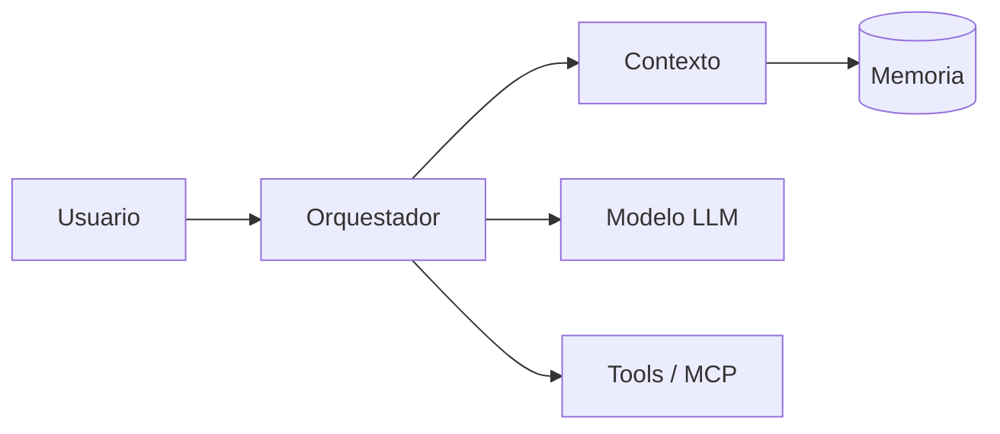

# Arquitectura

> Última revisión: **[COMPLETAR: AAAA-MM-DD]**

> **[COMPLETAR]** Resumen de 2-3 líneas del diseño general.
> *Ej: JARVIS usa un bucle de agente que coordina el modelo, las herramientas y la memoria.*

## Diagrama general

> **[COMPLETAR]** Diagrama de componentes (Mermaid o ASCII).



## Grafo de dependencias

> **[COMPLETAR]** Ruta del SVG generado con Madge.


```bash
# Regenerar (requiere Graphviz)
npx madge --extensions ts,tsx --ts-config tsconfig.json --image docs/assets/deps.svg src/
# Detectar dependencias circulares
npx madge --extensions ts,tsx --ts-config tsconfig.json --circular src/
```

## Componentes y responsabilidades

> **[COMPLETAR]** Un componente por fila. Ruta real del código incluida.

| Componente | Responsabilidad | Ruta |
|------------|----------------|------|
| *Ej: Orquestador* | *Controla el bucle del agente* | `src/core/agent.ts` |
| *Ej: Context Builder* | *Arma el prompt enviado al modelo* | `src/context/` |
| *Ej: Tool Executor* | *Ejecuta herramientas y MCP* | `src/tools/` |
| *Ej: Memory Store* | *Persiste historial y memoria* | `src/memory/` |

## Dependencias entre módulos

> **[COMPLETAR]** Quién depende de quién. Señalar dependencias prohibidas.

| Módulo | Depende de | No debe depender de |
|--------|-----------|---------------------|
| *Ej: core* | *context, tools* | *UI* |
| *Ej: tools* | *security* | *core* |

## Modelo y parámetros

> **[COMPLETAR]** Modelo(s) usados y configuración.

| Parámetro | Valor |
|-----------|-------|
| Modelo principal | *Ej: claude-sonnet-…* |
| Temperatura | *Ej: 0.2* |
| Máx. tokens de salida | *Ej: 4096* |
| Streaming | *Ej: sí* |
| Fallback | *Ej: modelo secundario si falla el principal* |

## Decisiones de diseño

> **[COMPLETAR]** Decisiones clave y su motivo (máx. 5).

- *Ej: Las herramientas se registran dinámicamente → permite añadir MCP sin tocar el core.*

## Archivos relacionados

> **[COMPLETAR]** Solo los 5-8 archivos clave (entry points, interfaces, config).

| Ruta | Rol |
|------|-----|
| *Ej: `src/core/agent.ts`* | *Bucle principal* |
| *Ej: `src/config/models.ts`* | *Modelo y parámetros* |