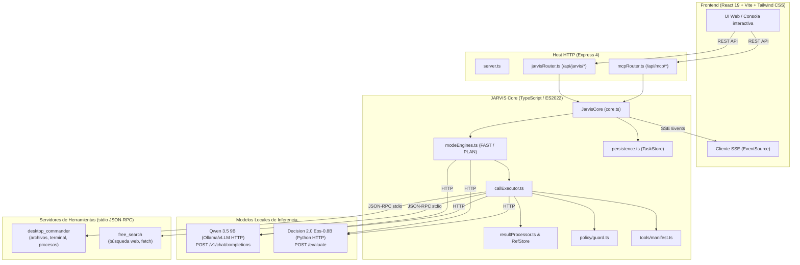

# Arquitectura de JARVIS Core

JARVIS es un sistema de asistencia y automatización determinista que orquesta la ejecución supervisada de tareas en el entorno local (sistema de archivos, terminal, procesos) y la web. Su diseño desacopla la **planificación y generación de argumentos** (a cargo de un LLM de razonamiento: Qwen 3.5), la **clasificación y verificación factual** (a cargo de un modelo discriminativo estructurado: Decision 2.0 / Eos-0.8B), y la **ejecución segura de acciones** (mediante servidores MCP locales bajo una compuerta estricta de políticas: Guard).

---

## 1. Principios de Diseño

1. **Determinismo y separación de modelos:**
   - Ningún modelo LLM ejecuta herramientas directamente.
   - El clasificador **Decision 2.0 (Eos-0.8B)** se encarga de la navegación estructural (Decision #1: destino) y de la selección precisa de herramientas (Decision #2).
   - El razonador **Qwen 3.5 9B** se encarga de descomponer objetivos en etapas, formular argumentos conformes a esquemas JSON, sintetizar respuestas finales y actuar como supervisor semántico de etapa en modo PLAN.
   - Eos actúa como verificador factual inmediato de cada paso ejecutado antes de darlo por bueno.
2. **Seguridad fail-closed (Guard):**
   - Toda herramienta que muta el sistema (`policy.mutates === true`, como escritura de archivos o ejecución de comandos) requiere aprobación explícita del usuario o una política preautorizada. Si una herramienta no está catalogada en el manifest, la acción se bloquea por defecto.
3. **Aislamiento de contexto y referencias deterministas (`RefStore`):**
   - Las salidas extensas de herramientas (archivos leídos, salidas de consola, listados web) se almacenan aisladas en memoria por tarea bajo tokens deterministas (`ref:r1`, `ref:r2`).
   - Los modelos de razonamiento y clasificación reciben observaciones compactas (`compactObs`) acotadas en caracteres. Si un paso posterior necesita el contenido completo, Qwen inyecta el token de referencia en los argumentos y `RefResolver` lo sustituye deterministamente antes del despacho.
4. **Resiliencia y trazabilidad sin inferencias en silencio:**
   - La infraestructura HTTP no realiza inferencias automáticas ni asume datos inexistentes. Salidas inválidas, rutas desconocidas o discrepancias de tipos invalidan el paso y disparan reintentos estructurados o replanificación autónoma.

---

## 2. Fronteras del Sistema y Servicios Externos

El sistema se compone de tres capas principales y dos backends de inteligencia artificial locales:



---

## 3. Módulos del Núcleo y Responsabilidades

| Módulo | Ruta | Responsabilidad Principal |
|---|---|---|
| **`core.ts`** | `src/core/core.ts` | Fachada principal del orquestador. Gestiona el ciclo de vida de tareas en memoria (`activeTasks`), despacho de eventos SSE (`emitEvent`), confirmación/rechazo de planes, aprobación humana de Guard (`provideApproval`), reanudación ante preguntas al usuario (`provideUserAnswer`) y coordinación con la persistencia. |
| **`modeEngines.ts`** | `src/core/modeEngines.ts` | Implementa los dos motores de ejecución: el loop reactivo directo (**FAST**) y el pipeline por etapas supervisado (**PLAN**), gestionando transiciones de estado, replanificación localizada y cierre de tareas. |
| **`callExecutor.ts`** | `src/core/callExecutor.ts` | Ejecutor atómico de herramientas: redescubrimiento dinámico de esquemas, generación de argumentos con Qwen, sustitución determinista de referencias (`RefResolver`), evaluación de Guard, despacho MCP, procesamiento de resultados con `ResultProcessor`, verificación factual con Eos y cálculo de hand-off para el siguiente paso. |
| **`resultProcessor.ts`** | `src/core/processor/resultProcessor.ts` | Parsea resultados MCP crudos. Aplica extractores específicos por herramienta (`read_file`, `list_directory`, `process`, `search`, `fetch`, genérico), calcula señales de ejecución (`exit_code`, `timeout`, `not_found`, `empty_output`), genera la observación compacta acotada (`compactObs`), los hechos de memoria (`factsDelta`) y gestiona el almacén de referencias en memoria (`RefStore`). |
| **`refResolver.ts`** | `src/core/processor/refResolver.ts` | Sustituye tokens de referencia `{{ref:rX}}` o `ref:rX` por los contenidos reales almacenados en `RefStore` dentro del payload de argumentos antes de que la llamada pase por Guard y se envíe al servidor MCP. |
| **`decision.ts`** | `src/core/decision.ts` | Cliente HTTP del servicio Decision 2.0 (Eos-0.8B). Expone `evaluateDecisionOne` (enrutamiento de destino o finalización), `evaluateDecisionTwo` (selección de herramienta dentro del destino) y `evaluateStepVerification` (juicio factual `ok` y `cumple`). |
| **`qwen.ts`** | `src/core/reasoner/qwen.ts` | Cliente HTTP OpenAI-compatible para Qwen. Implementa generación de argumentos, planes iniciales, replanificaciones, respuestas finales y verificación semántica de etapas (`verifyStage`), con políticas estrictas de timeouts, cancelación y reintento único ante salida inválida o truncada. |
| **`prompts.ts`** | `src/core/reasoner/prompts.ts` | Biblioteca centralizada de plantillas de prompts: prompts de sistema estables (optimizados para prefix-cache), presupuestos estrictos de caracteres por sección, sanitización de delimitadores `<obs>` y notas de corrección para reintentos. |
| **`llmTransport.ts`** | `src/core/llmTransport.ts` | Transporte HTTP de bajo nivel compartido por Qwen y Decision. Gestiona el presupuesto total de timeout mediante `AbortSignal.timeout`, propaga cancelaciones de usuario (`RequestAbortedError`) sin reclasificarlas, y reintenta errores de red o HTTP 503 una sola vez con backoff. |
| **`manifest.ts`** | `src/core/tools/manifest.ts` | Fuente única de verdad del catálogo de herramientas autorizadas. Asigna cada herramienta a una de las 4 rutas ejecutables (`files`, `locate`, `terminal`, `web`), define sus capabilities, requerimientos de aprobación y si la herramienta muta el entorno. |
| **`guard.ts`** | `src/core/policy/guard.ts` | Evaluador determinista de seguridad. Examina la política de la herramienta y los argumentos para emitir una decisión: `ALLOW` (ejecución directa), `APPROVAL` (suspende en espera de autorización humana en UI) o `DENY` (bloqueo terminal). |
| **`persistence.ts`** | `src/core/persistence.ts` | Motor de almacenamiento persistente en disco: `TaskStore` (guarda `.jarvis/tasks.json` con debounce de 500 ms, escritura atómica vía `.tmp` y cuarentena `.corrupt` ante corrupciones). |
| **`context.ts`** | `src/core/context.ts` | Ensambla bloques de contexto para los prompts: historial de acciones recientes, hechos (`facts`), efectos acumulados en el entorno (`effects`), fallos previos (`fail`) y descriptores de referencias activas. |
| **`environment.ts`** | `src/core/environment.ts` | Detecta las rutas del sistema del usuario (carpeta personal, escritorio, documentos, descargas) y el shell predeterminado para anclar los prompts a rutas reales de la máquina. |
| **`config.ts`** | `src/core/config.ts` | Carga, valida y persiste la configuración operativa (`jarvis-config.json`): URLs de modelos, límites de tokens, timeouts y comandos de inicio de servidores MCP. |
| **`types.ts`** | `src/core/types.ts` | Definiciones canónicas de interfaces (`Task`, `Step`, `StepCall`, `Plan`, `Evidence`), estados (`TaskState`, `StepState`, `VerificationState`), rutas y constantes globales. |

---

## 4. Servidores MCP y Rutas Funcionales

El manifest (`manifest.ts`) agrupa las herramientas del sistema en **4 rutas ejecutables cerradas** (`ExecutableRoute`), cada una asignada a un único servidor MCP:

```
Rutas Ejecutables (Decision #1)
├── "files"    ──► desktop_commander (read_file, write_file, list_directory, move_file...)
├── "locate"   ──► desktop_commander (start_search, get_more_search_results)
├── "terminal" ──► desktop_commander (start_process, read_process_output, interact_with_process)
└── "web"      ──► free_search       (search, fetch, fetch_batch)
```

Cualquier herramienta devuelta por un servidor MCP que no figure explícitamente en el manifest es filtrada por `applyDestination` y no se expone a los modelos ni a la ejecución.

---

## 5. Eventos y Flujo de Comunicación (SSE)

`JarvisCore` extiende un patrón de observabilidad en tiempo real. Cuando cambia el estado interno de una tarea, se emite un `CoreEvent` que `jarvisRouter.ts` retransmite a la UI a través de un canal Server-Sent Events (`/api/jarvis/events`):

- `TASK_CREATED`: Tarea inicializada y registrada en memoria.
- `TASK_STATE_CHANGED`: Cambio de estado (`RUNNING`, `WAITING_INPUT`, `COMPLETED`, `FAILED`, `CANCELLED`).
- `PLAN_GENERATED`: Plan inicial generado o plan reformulado por replanificación.
- `STEP_STATE_CHANGED`: Un paso cambia de estado (`RUNNING`, `COMPLETED`, `FAILED`, `BLOCKED`, `UNVERIFIED`).
- `APPROVAL_REQUESTED`: La ejecución se suspendió porque Guard exige confirmación del usuario para una acción mutante.
- `APPROVAL_RESOLVED`: El usuario autorizó o denegó la acción pendiente.
- `MCP_DISPATCHED`: Llamada a herramienta enviada al servidor MCP.
- `MCP_RESULT`: Salida cruda recibida del servidor MCP.
- `RESULT_PROCESSED`: Extracción determinista finalizada y lista para verificación.
- `STAGE_VERIFIED`: Juicio semántico emitido por Qwen en modo PLAN.
- `STEP_COMPLETED`: Paso concluido con su registro de llamadas (`StepCall`).
- `FINAL_RESPONSE`: Generación de la síntesis final terminada.
