# Arquitectura

> Última revisión: **2026-10-11**

JARVIS Core implementa una arquitectura determinista full-stack desacoplada: el backend en Node.js (`server.ts` y `src/core/core.ts`) actúa como autoridad de ejecución orquestando los modos FAST y PLAN, mientras que la interfaz en React/Vite (`src/App.tsx`) opera como cliente reactivo mediante HTTP y Server-Sent Events. El orquestador integra Decision 2.0 para enrutamiento y evaluación estructurada, Qwen 3.5 9B para generación de argumentos, planificación y síntesis final, y servidores locales MCP (Windows, Desktop Commander y Free Search) por transporte stdio bajo la supervisión estricta de la compuerta de seguridad Guard y el registro de políticas.

## Diagrama general

```mermaid
flowchart TD
    subgraph UI ["Capa de Presentación (React / Vite)"]
        Browser["Usuario / Navegador"]
        App["App.tsx / useJarvis"]
        TopBar["TopBar & ModeSelector"]
        CommandSec["CommandSection"]
        GuardUI["GuardBanner (Aprobaciones)"]
        FlowUI["ProcessFlow & Timeline"]
        ContextUI["ContextInspector"]
    end

    subgraph Host ["Host Autoritativo (Node.js Express - server.ts)"]
        RouterJarvis["/api/jarvis/* (Process, Cancel, Approve, State)"]
        RouterSSE["/api/jarvis/events (Server-Sent Events)"]
        RouterMCP["/api/mcp/* (Direct Calls & Tools)"]
    end

    subgraph CoreEngine ["Núcleo Orquestador (JarvisCore - src/core/)"]
        Core["JarvisCore (core.ts)"]
        ModeFast["FAST Mode (runFastLoop)"]
        ModePlan["PLAN Mode (runPlanLoop / Replan)"]
        CallExec["CallExecutor (executeCall)"]
        CtxMgr["Context & Memory Helpers (context.ts)"]
    end

    subgraph Reasoning ["Modelos & Razonamiento"]
        D2Engine["Decision20Engine (decision.ts)"]
        D2Service[("Decision 2.0 HTTP /v1/decide")]
        QwenEng["QwenEngine (qwen.ts)"]
        OllamaService[("Qwen 3.5 9B /v1/chat/completions")]
        PromptCentral["Prompts Centralizados (prompts.ts)"]
    end

    subgraph Security ["Seguridad & Políticas"]
        Guard["Guard (guard.ts)"]
        PolicyReg["PolicyRegistry (policyRegistry.ts)"]
    end

    subgraph MCPBridge ["Capa MCP & Descubrimiento"]
        DiscEng["DiscoveryEngine (discovery.ts)"]
        Transport["StdioMcpTransport (transport.ts)"]
        WinServer["WindowsMCPServer (windows-mcp)"]
        DeskServer["DesktopCommanderMCPServer (desktop-commander)"]
        SearchServer["FreeSearchMCPServer (free-search-mcp)"]
    end

    subgraph DataStorage ["Persistencia & Aislamiento"]
        ResultProc["ResultProcessor (resultProcessor.ts)"]
        RefStore[("RefStore (Memoria por tarea)")]
        TaskFile[("jarvis-tasks.json (Disco)")]
        ConfigFile[("jarvis-config.json (Disco)")]
    end

    %% Relaciones
    Browser --> App
    App --> RouterJarvis
    App --> RouterSSE
    RouterJarvis --> Core
    Core --> ModeFast & ModePlan
    ModeFast & ModePlan --> CallExec
    
    CallExec --> D2Engine
    CallExec --> QwenEng
    D2Engine --> D2Service
    QwenEng --> OllamaService
    D2Engine & QwenEng -.-> PromptCentral
    
    CallExec --> Guard
    Guard --> PolicyReg
    Guard -.->|APPROVAL| GuardUI
    
    CallExec --> DiscEng
    DiscEng --> WinServer & DeskServer & SearchServer
    WinServer & DeskServer & SearchServer --> Transport
    
    CallExec --> ResultProc
    ResultProc --> RefStore
    ResultProc --> CtxMgr
    Core --> TaskFile
    Core --> ConfigFile
```



## Grafo de dependencias


> **Nota de verificación:** La ejecución de `npx madge --circular src/` en el código fuente actual concluye exitosamente: `✔ No circular dependency found!`. La generación del archivo gráfico SVG `docs/assets/deps.svg` requiere la utilidad de sistema Graphviz (`gvpr` en `$PATH`); en entornos donde Graphviz no está preinstalado, el comando falla con `spawn gvpr ENOENT`.

```bash
# Regenerar (requiere Graphviz instalado en el sistema operativo)
npx madge --extensions ts,tsx --ts-config tsconfig.json --image docs/assets/deps.svg src/
# Detectar dependencias circulares (verificado: 0 dependencias circulares)
npx madge --extensions ts,tsx --ts-config tsconfig.json --circular src/
```

## Componentes y responsabilidades

| Componente | Responsabilidad | Ruta |
|------------|----------------|------|
| Host HTTP & API | Expone endpoints REST (`/api/jarvis/*`, `/api/mcp/*`), canal SSE de eventos y gestiona el ciclo de vida de procesos | `server.ts` |
| Orquestador Central (`JarvisCore`) | Coordina el ciclo de vida de tareas, concurrencia, persistencia en disco y despacho de eventos reactivos | `src/core/core.ts` |
| Motores de Ejecución (`ModeEngines`) | Implementa los bucles de ejecución para modo FAST (`runFastLoop`) y PLAN (`initiatePlanMode`, `runPlanLoop`), escalación (5B) y replan | `src/core/modeEngines.ts` |
| Ejecutor de Llamadas (`CallExecutor`) | Ejecuta el ciclo de un paso de tool: consulta a D2, genera argumentos con Qwen, verifica anti-loop, evalúa con Guard, despacha al MCP y procesa el resultado | `src/core/callExecutor.ts` |
| Motor de Decisión (`Decision20Engine`) | Cliente HTTP para el modelo de decisiones estructuradas Decision 2.0; ejecuta D1 (enrutamiento), D2 (selección de tool), D5 (evaluación) y juicio de plan | `src/core/decision.ts` |
| Razonador LLM (`QwenEngine`) | Cliente HTTP para Qwen 3.5 9B; genera argumentos con validación de schema, planes estructurados, replanificación, análisis de escalación y respuesta final | `src/core/reasoner/qwen.ts` |
| Prompts Centralizados (`Prompts`) | Centraliza plantillas de sistema y constructores de prompts para Qwen y Decision 2.0 con delimitación segura (`safe()`) y recorte de contexto | `src/core/reasoner/prompts.ts` |
| Compuerta de Seguridad (`Guard`) | Evalúa si una llamada está permitida (ALLOW), prohibida (DENY) o requiere autorización humana (APPROVAL); inspecciona comandos de terminal de forma dinámica | `src/core/policy/guard.ts` |
| Registro de Políticas (`PolicyRegistry`) | Mapeo estático y determinista de pares (servidor MCP, herramienta) a capacidades y tipos de acción (READ vs no-READ) | `src/core/policy/policyRegistry.ts` |
| Procesador de Resultados (`ResultProcessor`) | Extrae hallazgos compactos, señales de ejecución, deltas de scratchpad/facts, genera evidencias y resúmenes estructurados para Decision 2.0 | `src/core/processor/resultProcessor.ts` |
| Almacén de Referencias (`RefStore`) | Almacén en memoria de salidas completas de herramientas indexadas por clave de referencia (`r1`, `r2`...), aislado por `taskId` | `src/core/processor/resultProcessor.ts` |
| Motor de Descubrimiento (`DiscoveryEngine`) | Descubre dinámicamente herramientas (`tools/list`), plantillas de recursos y prompts de servidores MCP; limpia esquemas de entrada y cachea resultados | `src/core/mcp/discovery.ts` |
| Transporte MCP (`StdioMcpTransport`) | Gestiona procesos hijos persistentes por stdio con protocolo JSON-RPC 2.0, enmarcado de líneas, control de timeouts y terminación de árboles de procesos | `src/core/mcp/transport.ts` |
| Adaptadores MCP (`Windows`, `Desktop`, `Search`) | Implementaciones de `IMCPServer` que encapsulan la comunicación stdio con `windows-mcp`, `@wonderwhy-er/desktop-commander` y `free-search-mcp` | `src/core/mcp/windowsMcp.ts`, `src/core/mcp/desktopCommanderMcp.ts`, `src/core/mcp/freeSearchMcp.ts` |
| Gestor de Configuración (`ConfigManager`) | Administra y persiste las URLs y comandos de servicios en `jarvis-config.json` | `src/core/config.ts` |
| Contexto y Memoria (`Context Helpers`) | Gestiona `TaskExecutionContext`, colapso estadístico de LOG, cola FAIL, FACTS y formateo de intentos previos | `src/core/context.ts` |
| Cliente Web React (`App` y Hooks) | Interfaz gráfica de usuario con suscripción a eventos SSE, historial de tareas, inspección de contexto y compuerta de aprobación | `src/App.tsx`, `src/hooks/useJarvis.ts`, `src/services/jarvisApi.ts` |

## Dependencias entre módulos

| Módulo | Depende de | No debe depender de |
|--------|-----------|---------------------|
| `src/core/core.ts` | `decision`, `discovery`, `qwen`, `context`, `callExecutor`, `resultProcessor`, `modeEngines`, `types` | UI (`src/components/`, `src/hooks/`) |
| `src/core/modeEngines.ts` | `context`, `callExecutor`, `resultProcessor`, `qwen`, `types` | UI, servidores Express |
| `src/core/callExecutor.ts` | `decision`, `discovery`, `guard`, `policyRegistry`, `qwen`, `resultProcessor`, `context`, `types` | UI, `core.ts` directamente (usa `EngineDependencies`) |
| `src/core/decision.ts` | `config`, `prompts`, `types` | `core.ts`, transportes MCP, UI |
| `src/core/reasoner/qwen.ts` | `config`, `prompts`, `discovery` (`cleanInputSchema`), `types` | `core.ts`, UI, transportes MCP |
| `src/core/policy/guard.ts` | `policyRegistry`, `types` | Modelos LLM (`qwen.ts`, `decision.ts`), ejecutores, UI |
| `src/core/policy/policyRegistry.ts` | `types` | Ningún otro módulo (registro estático independiente) |
| `src/core/processor/resultProcessor.ts` | `policyRegistry`, `types` | `callExecutor.ts`, `core.ts`, UI |
| `src/core/mcp/discovery.ts` | `mcp/types`, `types` | `core.ts`, UI |
| `src/core/mcp/transport.ts` | `config`, `mcp/types`, `types`, `node:child_process` | Modelos LLM, `core.ts`, UI |
| `src/core/mcp/*Server.ts` | `transport`, `config`, `mcp/types`, `types` | `core.ts`, UI |
| `src/hooks/useJarvis.ts` & `services` | `types`, `mcp/types`, `utils/apiUrl` | `core.ts`, `node:child_process`, `node:fs` (código de navegador) |
| `server.ts` | Todos los módulos de backend de `src/core/`, `express`, `dotenv`, `node:fs`, `node:path` | Componentes React de UI |

## Modelo y parámetros

| Parámetro | Valor |
|-----------|-------|
| Modelo principal de razonamiento | `qwen3.5:9b` (configurable en `jarvis-config.json:qwenModel`) |
| Endpoint principal de razonamiento | `http://127.0.0.1:11434/v1/chat/completions` (configurable en `qwenUrl`) |
| Temperatura (Qwen) | `0.1` (fijada en `dispatchPrompt`) |
| Ventana de contexto (Qwen) | `8192` tokens (`QWEN_CTX = 8192`, parámetro `num_ctx`) |
| Máx. tokens de salida (Qwen) | Etapa 3 (Argumentos): `1024` · Etapa 5B (Escalación): `500` · Etapa 6 (Final): `1000` · PLAN (Plan/Replan): `1500` |
| Streaming (Qwen) | `false` (desactivado en todas las etapas en `dispatchPrompt`) |
| Modo de razonamiento (Qwen thinking) | `none` por defecto (`thinking: false` en config); `low` en Escalación (`QWEN_ESCALATION_THINKING = true`) |
| Formato de salida (Qwen) | `json_object` estándar o `json_schema` estricto (`PLAN_JSON_SCHEMA`, `REPLAN_JSON_SCHEMA`) |
| Timeout (Qwen) | `60000 ms` (`qwenTimeoutMs` en `jarvis-config.json`, fallback a 60 s) |
| Reintentos de argumentos (Qwen) | `MAX_ARG_RETRIES = 2` (ante schema validation failure) |
| Modelo clasificador estructurado | `Decision-2.0-Kai-0.6B` / `Decision-2.0-Eos-0.8B` |
| Endpoint clasificador | `http://127.0.0.1:8765/v1/decide` (configurable en `decisionUrl`) |
| Ventana de contexto (Decision 2.0) | `8192` tokens (límite evaluado con `Math.ceil(state.length / 3.5) + questions * 40 <= 8192`) |
| Tipos de preguntas (Decision 2.0) | `choice` (2-255 opciones), `noul` (probabilidad [0.0, 1.0]), `score` (escala ordinal 2-10) |
| Umbral de confianza Decision #1 | `0.51` normal (`DECISION_MIN_CONFIDENCE`) · `0.60` post-acción (`DECISION_MIN_CONFIDENCE_POST_ACTION`) |
| Umbral de juicio en modo PLAN | `0.60` (`evaluatePlanJudgement`: exige choice `"cumple"` y `confidence >= 0.60`) |
| Umbral de dependencia de contexto | `0.60` (`evaluateDecisionOne`: activa `needsContext` si `needsContextAnswer.noul >= 0.60`) |
| Umbral override Decision #5 | `0.50` (`DECISION_OVERRIDE_CONFIDENCE_THRESHOLD`); si exit_code=0 y sin señales de error, fuerza `correcta` |
| Timeout (Decision 2.0) | `30000 ms` (`decisionTimeoutMs` en `jarvis-config.json`) |
| Fallback clasificador | En Decision #1, si `fin` no alcanza el umbral de confianza, se selecciona la mejor ruta no-fin alternativa según probabilidades; en Decision #5, fallback sintético `correcta` si exit_code=0 y no hay señales de error |

## Decisiones de diseño

- **Separación de roles entre Clasificador Estructurado y Generador LLM:** Decision 2.0 se especializa en decisiones categóricas (enrutamiento de subsistema en D1, selección de tool en D2 y evaluación en D5) mediante probabilidades calibradas, mientras Qwen 3.5 9B se reserva para generación de argumentos conforme a esquema, replanificación y síntesis de respuesta en lenguaje natural.
- **Descubrimiento dinámico de herramientas MCP sin catálogos estáticos:** Las capacidades disponibles no están prefijadas; se consultan en tiempo de ejecución invocando `tools/list`, `prompts/list` y `resources/templates/list` por stdio en cada servidor, limpiando esquemas para eliminar ruido y permitiendo refresco en caliente (`refreshDiscovery`).
- **Compuerta de seguridad Guard independiente e inviolable:** Ningún modelo LLM puede autorizar operaciones sensibles ni mutar las políticas de seguridad. Acciones destructivas reciben `DENY` incondicional, comandos de inspección segura reciben `ALLOW` automático, y mutaciones de archivos o comandos de terminal requieren autorización humana obligatoria (`APPROVAL`).
- **Ejecución autoritativa desacoplada en backend Node.js:** Todo el ciclo de vida del agente, subprocesos de MCP por stdio y persistencia de tareas residen en el host de Node.js; el frontend web interactúa como visor reactivo mediante llamadas REST y Server-Sent Events (SSE), evitando empaquetar binarios nativos en el navegador.
- **Almacén de referencias (`RefStore`) aislado por tarea con compresión de memoria:** Las salidas extensas de herramientas se guardan íntegras en memoria bajo identificadores de referencia (`r1`, `r2`...) y solo se inyectan resúmenes compactos y delimitados (`<obs>`) en los prompts, evitando desbordamiento del contexto de 8192 tokens.

## Archivos relacionados

| Ruta | Rol |
|------|-----|
| `server.ts` | Host Node.js full-stack, enrutadores Express (`/api/jarvis/*`, `/api/mcp/*`), SSE y ciclo de vida de procesos |
| `src/core/core.ts` | Orquestador principal `JarvisCore`, gestión del ciclo de vida de tareas, persistencia local y eventos reactivos |
| `src/core/types.ts` | Contratos de tipos, límites globales del sistema (`MAX_STEPS`, `MAX_TOOL_CALLS_TASK`, etc.) y estructuras |
| `src/core/modeEngines.ts` | Motores de ejecución de bucles (FAST, PLAN, escalación y replan) |
| `src/core/callExecutor.ts` | Ejecución determinista de llamadas a herramientas MCP y compuerta de aprobación humana |
| `src/core/decision.ts` | Cliente HTTP y validación de respuestas para el modelo Decision 2.0 |
| `src/core/reasoner/qwen.ts` | Cliente HTTP, esquemas estructurados y reintentos para Qwen 3.5 9B |
| `src/core/policy/guard.ts` | Motor de compuerta de seguridad, detección de comandos seguros y reglas de denegación |