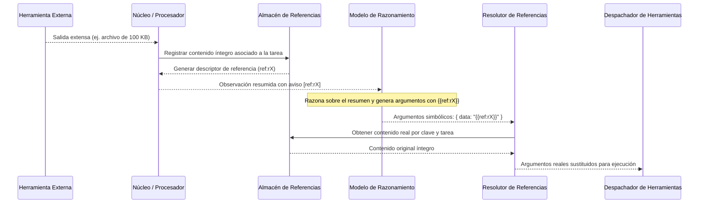

# Contexto, Memoria y Persistencia

JARVIS Core implementa un sistema estructurado de contexto, memoria jerárquica y persistencia diseñado para operar de forma eficiente y segura sobre modelos de lenguaje locales. Su arquitectura resuelve la tensión entre ventanas de inferencia acotadas y tareas complejas que requieren retención histórica, desacoplando el volumen de los datos observados de la capacidad de atención del modelo.

---

## 1. Propósito y Principios

El subsistema de contexto, memoria y persistencia garantiza continuidad cognitiva y ejecución determinista bajo cuatro principios arquitectónicos:

1. **Aislamiento ontológico:** Separación estricta entre directivas de ejecución y datos externos observados. La información proveniente del entorno jamás se interpreta como instrucciones para el modelo.
2. **Minimización del espacio de inferencia:** Los modelos reciben únicamente la información crítica y sintetizada requerida para su decisión inmediata. Los datos extensos se gestionan fuera del flujo de atención mediante direccionamiento indirecto.
3. **Conservación de evidencia:** La compresión del contexto para los modelos no destruye la información original; el contenido íntegro se preserva en capas auxiliares para su uso en herramientas posteriores y para auditoría del usuario.
4. **Resistencia a fallos e idempotencia:** El estado de las tareas sobrevive a cierres abruptos del proceso, y el historial de efectos secundarios protege al entorno contra repeticiones destructivas ante fallos parciales.

---

## 2. Flujo de Memoria de la Tarea

La memoria de una tarea se organiza en dos niveles con responsabilidades y ciclos de vida independientes: el **estado transitorio de trabajo** y la **memoria acumulativa de la tarea**.

```
TaskExecutionContext / Task
├── Scratchpad (Estado transitorio de trabajo)
│   └── Proyección volátil de la última observación (UI y heurística inmediata)
│
└── TaskMemory (Memoria acumulativa estructurada)
    ├── facts    ──► Hechos verificados sobre el entorno (con regla de retracción)
    ├── effects  ──► Mutaciones irreversibles consolidadas (permanentes ante replan)
    ├── fail     ──► Errores y desvíos detectados (poda de caminos fallidos)
    └── log      ──► Trazabilidad secuencial de acciones ejecutadas
```

### A. Estado Transitorio de Trabajo (`Scratchpad`)
* **Responsabilidad:** Representar la fotografía inmediata de la última observación realizada (rutas activas, identificadores de procesos en ejecución, metadatos de búsqueda).
* **Ciclo de vida:** Se sobrescribe o complementa con el delta de cada paso. No conserva acumulación histórica; su función es servir como soporte de visibilidad inmediata para la interfaz de usuario y enriquecer el contexto heurístico del selector de herramientas.

### B. Memoria Acumulativa de la Tarea (`TaskMemory`)
Persiste durante todo el ciclo de vida de la tarea y gobierna el razonamiento deliberativo mediante cuatro canales especializados:

* **Hechos verificados (`facts`):**
  * *Admisión:* Solo se incorporan si la evidencia del paso superó la verificación factual o si representan el resultado de una mutación confirmada en el entorno. Los datos hipotéticos o de verificación dudosa se descartan.
  * *Invariante de retracción:* Si una etapa posterior resulta bloqueada o con información insuficiente, los hechos provisionales generados por dicho paso se retractan de la memoria para evitar alucinaciones en decisiones futuras.
  * *Excepción a la retracción:* Los hechos que describen mutaciones reales del entorno (como el identificador de un proceso iniciado) no se retractan, ya que reflejan un cambio físico real que el sistema no puede ignorar.

* **Efectos secundarios (`effects`):**
  * *Responsabilidad:* Registrar mutaciones permanentes aplicadas sobre el sistema operativo, archivos o servicios externos.
  * *Invariante de replanteamiento:* Los efectos acumulados son estrictamente acumulativos y nunca se descartan durante una replanificación. Si una etapa falla y obliga a generar un nuevo plan, el planificador recibe el historial íntegro de efectos previos para diseñar caminos alternativos sin volver a ejecutar acciones ya consumadas.

* **Historial de fallos (`fail`):**
  * *Responsabilidad:* Registrar desvíos lógicos, argumentos inválidos y bloqueos de políticas de seguridad.
  * *Propósito:* Actúa como memoria negativa para podar el árbol de búsqueda de los modelos, impidiendo que reintenten estrategias o comandos que ya demostraron ser inviables.

* **Registro secuencial (`log`):**
  * *Responsabilidad:* Trazabilidad cronológica de las acciones ejecutadas y sus conclusiones sintéticas, permitiendo que los modelos evalúen el progreso global de la tarea.

---

## 3. Construcción y Control del Contexto

La construcción del contexto traduce la memoria acumulada y el estado actual al formato de entrada de los modelos locales, equilibrando relevancia y consumo de tokens.

### A. Inmunidad ante Inyecciones de Datos
Todo contenido proveniente del exterior (salidas de comandos, lectura de archivos, recursos web o respuestas de herramientas) pasa por una barrera de sanitización y delimitación formal:
* Se neutralizan delimitadores de control y caracteres especiales que pudieran romper el formato del prompt o simular el cierre de bloques.
* El contenido se encierra en etiquetas explícitas de observación (`<obs>...</obs>`).
* El sistema instruye de forma invariable al modelo para que interprete todo contenido dentro de esas etiquetas estrictamente como datos pasivos analizados, despojándolo de cualquier capacidad directiva sobre la ejecución.

### B. Estructura Optimizada para Inferencia (Prefix-Caching)
Para maximizar la tasa de acierto de claves/valores en caché (*prefix-caching*) de los servidores de inferencia locales, los prompts se construyen siguiendo un orden determinista:
1. **Bloques estables primero:** Directivas de sistema, convenciones de salida, descripciones de herramientas y políticas invariantes.
2. **Contexto acumulado intermedio:** Efectos consolidados, hechos confirmados, historial de acciones y fallos previos.
3. **Bloques dinámicos al final:** El objetivo específico de la tarea y la observación inmediata del paso activo.

### C. Estrategia de Selección y Poda de Contexto
Cuando la información histórica excede los límites operativos de inferencia, el sistema aplica políticas de reducción que preservan la coherencia:
* **Preservación de la cola (*tail preservation*):** En registros cronológicos (historial de acciones, fallos, observaciones), se descartan las entradas antiguas y se retienen las más recientes para asegurar que el modelo razone sobre la consecuencia directa de su última acción.
* **Compresión semántica:** Las observaciones complejas se sintetizan en resúmenes compactos antes de su inclusión en el prompt.
* **Expansión progresiva:** La profundidad de recuperación contextual inicia en un nivel mínimo y se amplía progresivamente solo si el motor de decisión detecta ambigüedad o incapacidad de arbitraje con el contexto base.

---

## 4. Gestión de Referencias

Para manipular volúmenes de datos que exceden la ventana de contexto (documentos extensos, listados masivos, volcados de terminal), el sistema utiliza un patrón de direccionamiento indirecto mediante un almacén de referencias.



### Invariantes del Sistema de Referencias:
1. **Aislamiento por tarea:** Las referencias se almacenan en contenedores estrictamente segregados por el identificador de la tarea. Ninguna tarea puede resolver, modificar o consultar referencias pertenecientes a otra.
2. **Sustitución determinista pre-ejecución:** Cuando un modelo requiere procesar o reenviar un contenido previo, emite un token de referencia simbólico (`{{ref:rX}}`). Antes de validar permisos de seguridad y despachar la herramienta, el resolutor de referencias sustituye el token por el contenido original exacto.
3. **No recursividad:** El contenido inyectado tras una resolución jamás se vuelve a escanear en busca de tokens adicionales, impidiendo ciclos de expansión o resoluciones anidadas.
4. **Ciclo de vida desacoplado:**
   * *Fase activa:* Las referencias residen en memoria volátil de acceso rápido mientras la tarea está en ejecución.
   * *Fase histórica:* Al concluir la tarea (éxito, fallo o cancelación), las referencias se descargan a un archivo de almacenamiento secundario en disco antes de liberar la memoria de la tarea. Esto permite que el usuario o la interfaz consulten la evidencia completa en el historial sin mantener ocupada la memoria RAM.
   * *Fase de purga:* Cuando una tarea se elimina formalmente del registro del sistema, su archivo histórico de referencias se destruye en el mismo acto.

---

## 5. Persistencia e Integridad del Estado

La persistencia asegura que el progreso de las tareas se conserve fielmente en almacenamiento secundario frente a reinicios planificados o interrupciones imprevistas del entorno.

### A. Escritura Atómica
Para evitar estados inconsistentes o archivos JSON dañados a mitad de escritura:
* El estado jamás se escribe directamente sobre el archivo definitivo.
* Los datos se serializan en un archivo temporal independiente en disco.
* Una vez completada la escritura en disco, se realiza una operación de reemplazo atómico sobre el archivo de destino. Ante bloqueos transitorios por procesos del sistema operativo, el subsistema aplica reintentos antes de recurrir a copias de contingencia.

### B. Coalescencia y Prioridad de Escrituras
* **Agrupamiento diferido (*debouncing*):** Para no saturar el sistema de archivos durante secuencias rápidas de operaciones, las solicitudes de guardado ordinarias se agrupan temporalmente, garantizando una escritura tras una ventana de inactividad o al alcanzarse un tiempo máximo de espera acumulada.
* **Persistencia síncrona en transiciones críticas:** Cuando una tarea cambia a estados que dependen de agentes externos (espera de entrada del usuario, cancelación o conclusión terminal), la persistencia se ejecuta de forma prioritaria para garantizar que el estado quede asegurado de inmediato.

### C. Resiliencia, Respaldo y Cuarentena
* **Copia de seguridad continua:** Tras cada carga exitosa del archivo principal, el sistema mantiene una copia de respaldo validada.
* **Aislamiento de corrupción:** Si el sistema detecta que el archivo de tareas contiene datos corruptos o ilegibles durante el arranque:
  1. Aísla de inmediato el archivo dañado renombrándolo con una marca de tiempo (cuarentena), garantizando que no sea destruido ni sobrescrito para permitir análisis posterior.
  2. Intenta restaurar el estado a partir de la última copia de seguridad conocida.
  3. Si no existe respaldo válido, inicializa un registro limpio sin colapsar el inicio del servidor.

### D. Volcado Final en Cierre de Proceso
El subsistema se acopla al ciclo de vida del entorno de ejecución. Si el proceso recibe una orden de terminación, se ejecuta un vaciado sincrónico forzado de cualquier mutación de estado pendiente en memoria, garantizando que ninguna tarea quede en un estado intermedio en disco.
