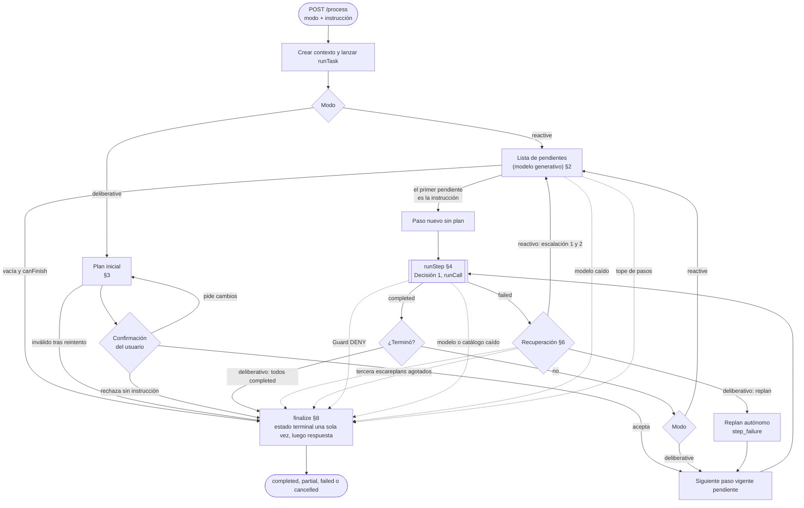
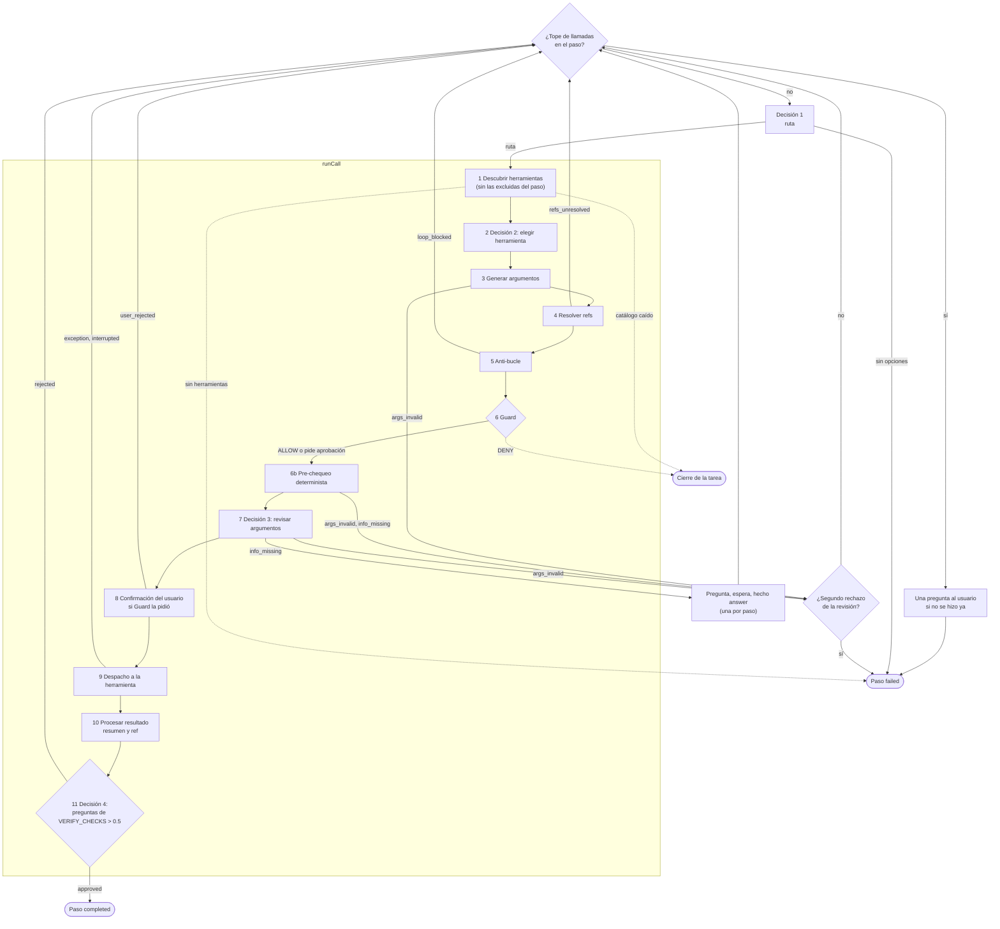

# Flujo de Ejecución y Orquestación

## 1. Ciclo de Vida
1. **Recepción**: la instrucción entra por `/process` con un modo (`reactive` o `deliberative`). La fachada crea el contexto de la tarea, lo registra y lanza `runTask` en segundo plano.
2. **Estrategia**: `runTask` ejecuta el modo elegido (§2 y §3). Es el único que decide cuándo y cómo se cierra la tarea.
3. **Ejecución por pasos**: cada paso consulta el destino (Decisión 1) y ejecuta llamadas (§4) hasta que una queda aprobada o el paso falla.
4. **Recuperación**: un paso fallido dispara la recuperación del modo: escalación en reactivo, replan en deliberativo (§6).
5. **Cierre**: `finalize` escribe el estado terminal una sola vez y, después, la respuesta final (§8).

### Mapa del flujo
Las flechas punteadas son los cierres de la tarea; todos pasan por `finalize` (§8). Los números de las cajas remiten a las secciones.

### Dentro de un paso
`runStep` (§4) elige el destino y `runCall` (§5) recorre las fases de la llamada. Cada rama de error vuelve al inicio del paso con lo ocurrido a la vista del modelo, salvo las marcadas como cierre o como falla del paso.

## 2. Modo Reactivo
Cada vuelta del bucle toma el primer ítem de la **lista de pendientes** y crea un paso nuevo, sin plan previo.

- **Lista de pendientes**: una consulta aparte al modelo generativo (sin razonamiento extendido) devuelve la lista completa de lo que falta para cumplir la solicitud. Recibe la solicitud, la lista de la vuelta anterior, lo hecho (con argumentos y resumen del resultado), los últimos intentos fallidos con su motivo y la entrada del usuario. La lista vive solo en el bucle; en el contexto entra únicamente la instrucción del paso. **La mantiene el código** (`pendingList.ts`): el modelo la genera al empezar, el paso que termina bien quita su ítem sin consultar, y solo se vuelve a consultar al modelo tras un paso fallido (para reescribir el ítem) o al vaciarse la lista (para confirmar que no falta nada). `reconcileList` evita que el modelo vuelva a agregar ítems ya cumplidos o abandonados y conserva los que venían detrás del reescrito.
- **Salida parcial**: un ítem con `maxItemFailures` (2) pasos fallidos seguidos se abandona si quedan otros; se ejecutan los restantes (p. ej. guardar lo obtenido) y la tarea cierra `no_alternatives` (`partial`), con lo no logrado en el encabezado de la respuesta final.
- **Instrucción del paso**: el primer pendiente. Decisión 1, 2, 3 y 4 y la generación de argumentos ven esa instrucción, no la solicitud completa.
- **Lista vacía**: significa que no queda nada por hacer y cierra la tarea según `canFinish`: `completed` si no hay llamadas o alguna está aprobada; `no_alternatives` si solo hubo rechazos del usuario. Sin llamadas (primera vuelta) o con solo fallos, una lista vacía no se acepta de inmediato: se consulta una vez más. Si en la primera vuelta vuelve vacía se acepta (la solicitud no necesita herramientas); si solo hubo fallos, la instrucción pasa a ser la solicitud entera.
- **Lista inválida**: un reintento y, si persiste, la tarea se cierra con `unrecoverable`.
- **Tope de pasos**: al llegar a `maxSteps` pasos (los fallidos cuentan) la tarea se cierra con `max_steps`.
- **Escalación**: un paso fallido es una escalación. Al tercero, la tarea se cierra con `no_alternatives`.

## 3. Modo Deliberativo
1. **Plan inicial**: el modelo generativo propone pasos (hasta el tope), cada uno con instrucción, ruta y resultado esperado. Un plan inválido tras el reintento cierra la tarea con `unrecoverable`.
2. **Confirmación humana**: la tarea espera la decisión del usuario.
   - *Aceptar*: se ejecutan los pasos.
   - *Pedir cambios* (con instrucción): se genera un plan nuevo (`user_feedback`), sin tope de veces, y se vuelve a pedir confirmación. Si el plan nuevo resulta inválido, se conserva el vigente y se vuelve a preguntar.
   - *Rechazar sin instrucción*: la tarea se cancela.
3. **Ejecución**: se toma el paso vigente pendiente y se corre con su ruta fija. La tarea se completa cuando todos los pasos vigentes quedan `completed`.
4. **Replan autónomo**: un paso fallido genera un plan nuevo (`step_failure`) sin pedir confirmación, hasta `maxReplans` veces. Los pasos no completados pasan a `superseded` y se agregan los nuevos; los completados nunca se repiten. El tope de pasos del plan nuevo es `maxSteps` menos los ya completados. Agotados los replans, o si el replan es inválido, la tarea se cierra con `replans_exhausted`.

## 4. Un Paso (`runStep`)
El paso repite este ciclo hasta que termina:

1. **Tope de llamadas**: si el paso ya hizo `maxCallsPerStep` llamadas (sin contar las rechazadas por el usuario), antes de fallar se le hace una pregunta al usuario, si todavía no se le hizo una en el paso; el paso falla igual y la respuesta queda a la vista de lo que siga (siguiente paso o replan).
2. **Decisión 1**: en ambos modos. Ofrece las rutas con alguna herramienta utilizable (en deliberativo, solo la ruta del paso). Si no queda ninguna opción, el paso falla (`no_tools`). Con una sola opción disponible, el modelo de decisión no se consulta.
3. **Llamada** (§5): si queda aprobada, el paso termina `completed`. Si el servidor deniega la herramienta, el paso falla. Una revisión que detecta `info_missing` hace una pregunta al usuario (una por paso): se genera con el modelo generativo, se espera la respuesta y se registra como hecho `answer_<paso>_<n>`. Una llamada bloqueada por el anti-bucle contra una llamada idéntica que la verificación ya aprobó da el paso por cumplido (`completed`: lo pedido ya está hecho); el segundo bloqueo del paso lo falla (`repeat_blocked`, `maxRepeatsPerStep`). Cualquier otro resultado (argumentos inválidos, referencias sin resolver, anti-bucle, revisión rechazada, rechazo del usuario o verificación rechazada) vuelve al inicio con lo ocurrido a la vista del modelo.
4. **Rechazos de la revisión**: al segundo `args_invalid` (el pre-chequeo y D3 lo producen; `tool_rejected` ya no se ofrece) en el mismo paso, el paso falla (`review_rejected`) y la recuperación del modo lo reencauza.

`ask_user` no es una opción de las decisiones: solo se pregunta en los dos casos de arriba (`info_missing` y tope de llamadas).

## 5. Una Llamada (`runCall`)
Fases en orden. Cada llamada se registra una sola vez, al terminar el intento, con su estado final.

| # | Fase | Qué ocurre si falla |
|---|---|---|
| 1 | **Descubrir** las herramientas del destino | Servidor o catálogo no disponible: se registra el error y la tarea se cierra (`unrecoverable`). Sin ninguna herramienta utilizable en ese momento, el paso falla (`no_tools`) |
| 2 | **Elegir herramienta** (Decisión 2). Solo se ofrecen las herramientas utilizables: las que dependen de un proceso activo o de una búsqueda iniciada aparecen solo mientras existan, y se excluye la que ya repitió en el paso una llamada idéntica que había fallado | — |
| 3 | **Generar argumentos** (modelo generativo, conforme al esquema) | Salida inválida tras el reintento: `args_invalid` |
| 4 | **Resolver referencias** `{{ref:rN}}` / `ref:rN` por su contenido en disco | Referencia desconocida: `refs_unresolved` |
| 5 | **Anti-bucle** sobre la huella de los argumentos resueltos | Repetición bloqueada: `loop_blocked` |
| 6 | **Guard** | `DENY`: la llamada queda `denied` y la tarea se cierra con `security_denied` |
| 6b | **Pre-chequeo determinista** (código, sin modelo; `engine/precheck.ts`): valores vacíos o `N/A`, marcadores de posición, rutas de otro usuario o de Linux, comandos que no existen en el sistema (parser de PowerShell), rutas de lectura y URLs que no aparecen en nada de lo que la tarea sabe. Ante la duda no rechaza | `args_invalid` o `info_missing`, con la razón escrita como resumen (llega a la línea FAIL del LLM de argumentos) |
| 7 | **Revisar argumentos**, solo en escrituras (`kind: write`; las lecturas pasan por el pre-chequeo y se aprueban) (Decisión 3; opciones `approved`, `args_invalid` e `info_missing`: no hay `tool_rejected`, la herramienta la elige Decisión 2) | `args_invalid` o `info_missing` |
| 8 | **Confirmación del usuario**, si Guard pidió aprobación. No se registra nada mientras se espera | Rechazo: `user_rejected`, con la instrucción opcional del usuario |
| 9 | **Despacho** a la herramienta, compitiendo contra la cancelación | Excepción: `exception`. Cancelación: `interrupted`, y un resultado tardío se descarta |
| 10 | **Procesar el resultado**: estado, resumen acotado y, si el resumen no contiene todo, el texto completo va a una ref en disco | — |
| 11 | **Verificar** (Decisión 4, §7) | Rechazada: vuelve al paso con el motivo |

## 6. Recuperación y Dudas
- **Reactivo**: tras un paso fallido, la lista de pendientes se regenera viendo los fallos con sus argumentos y puede reescribir la instrucción. Decisión 1 y 2 ven solo los intentos del paso actual; los de pasos anteriores los ve la lista. Una herramienta que repitió en el paso una llamada idéntica que había fallado deja de ofrecerse en ese paso; con otros argumentos sigue disponible. El anti-bucle compara contra toda la tarea.
- **Deliberativo**: replan autónomo (§3).
- **Información faltante**: la revisión detecta `info_missing`, la llamada se registra con ese estado y se pregunta al usuario, una vez por paso. También se pregunta antes de fallar por tope de llamadas.
- **Seguridad**: una denegación de Guard cierra la tarea sin escalar ni replanificar. Un rechazo del usuario sobre una operación no cierra la tarea: queda como `user_rejected` y el flujo continúa.

## 7. Verificación del Resultado
Decisión 4 evalúa las preguntas `noul` de la tabla `VERIFY_CHECKS` (`engine/deps.ts`) sobre cada llamada ejecutada: `ok` (¿la llamada tuvo éxito y trajo datos utilizables?) y `cumple` (¿el resultado satisface la instrucción del paso?). El criterio es siempre el paso: en reactivo, el primer pendiente.

- Aprueba solo si pasan todas, cada una con probabilidad estrictamente mayor que 0.5 (`verdictOf`).
- La razón es la de la primera pregunta que falla, en el orden de la tabla: si falla `ok`, `no_usable_data`; si falla solo `cumple`, `not_accomplished`.
- `tool_error` y `exception` se rechazan sin consultar al modelo. `interrupted` y `denied` no se verifican y quedan sin veredicto.
- Una respuesta inválida se repite una vez; si persiste, el servicio se considera no disponible.

## 8. Cierre y Respuesta Final
`finalize` escribe el estado terminal una sola vez y después la respuesta (`result`), con su origen:

- **`cancelled`**: siempre respuesta de respaldo, sin modelo.
- **Modelo generativo caído** (un fallo anterior ya lo marcó): respuesta de respaldo directa, sin consultarlo.
- **Resto de los cierres**: el modelo generativo redacta la respuesta con la vista final. Si la vista no entra en su reserva, o el modelo falla por cualquier causa, se entrega la respuesta de respaldo.

Cuando la tarea termina `partial` o `failed`, la respuesta del modelo va precedida de un **encabezado fijo** escrito por el código (`renderStatusNote`: estado, qué no se logró y cambios hechos en la computadora). El bloque `EFFECTS` dice "none" de forma explícita si no hubo cambios, y el prompt aclara que `read`/`write` junto a una herramienta es su tipo, no lo que hizo. Un `loop_blocked` muestra al modelo de argumentos los argumentos bloqueados y el mensaje pide cambiarlos; un rechazo con razón escrita oculta los argumentos.

La respuesta de respaldo es texto fijo, sin modelo: estado de la tarea, motivo de detención, fallos, cambios aplicados al entorno y últimas acciones. Su origen (`model` o `fallback`) queda registrado. El estado terminal nunca depende de cómo se redactó la respuesta.

## 9. Estados y Transiciones

| Estado | Condición |
|---|---|
| `running` | La tarea está en curso, incluidas las esperas del usuario (plan, aprobación o pregunta). |
| `completed` | Reactivo: lista de pendientes vacía con `canFinish` en `completed`. Deliberativo: todos los pasos vigentes `completed`. No lleva motivo. |
| `partial` | Se detuvo por `max_steps`, `replans_exhausted`, `no_alternatives` o `unrecoverable`, pero hubo efectos sobre el entorno o al menos una llamada aprobada. |
| `failed` | Se detuvo por `security_denied`, o por alguno de los motivos anteriores sin efectos ni llamadas aprobadas. |
| `cancelled` | El usuario canceló (`user_cancelled`), en cualquier momento. |

El motivo de detención es una lista cerrada: `max_steps`, `no_alternatives`, `security_denied`, `user_cancelled`, `replans_exhausted` y `unrecoverable` (falló un modelo o el catálogo de herramientas, o una vista no cupo en su límite; no la tarea en sí).

## 10. Errores y Límites
- **Transporte hacia modelos**: los fallos de red o HTTP 503 se reintentan una vez tras 1 s. El timeout y la cancelación nunca se reintentan.
- **Salidas inválidas o truncadas**: el modelo generativo reintenta una vez inyectando el motivo del error en el prompt; el modelo de decisión repite la consulta una vez. Si persiste: en argumentos es `args_invalid`; en la lista de pendientes, `unrecoverable`; en decisión y verificación, servicio no disponible.
- **Servicio no disponible**: se registra el error `service_unavailable` (si ya hay un paso) y la tarea se cierra con `unrecoverable`.
- **Desborde de contexto**: si un prompt no deja margen para la salida, o una vista no entra en su límite, la tarea se cierra con `unrecoverable` sin registrar error y sin repetir.
- **Cancelación cooperativa**: la señal de aborto llega a las esperas y a las llamadas en vuelo, y la tarea concluye sin tratarse como error. Una herramienta ya despachada queda `interrupted`.

Límites vigentes (definidos en `budget.ts` y `config.ts`; los timeouts y el contexto son valores por defecto):

| Límite | Valor |
|---|---|
| Pasos máximos (`maxSteps`) | 20 (reactivo: tope de la tarea; deliberativo: tope por plan) |
| Replans (`maxReplans`) | 3 |
| Escalaciones (reactivo) | 2 (la tercera cierra la tarea) |
| Llamadas por paso (`maxCallsPerStep`) | 6 (sin contar rechazos del usuario) |
| Bloqueos por repetición por paso (`maxRepeatsPerStep`) | 2 (el segundo falla el paso; si repetía una llamada ya aprobada, el paso se da por cumplido) |
| Rechazos de la revisión por paso (`maxReviewRejectionsPerStep`) | 2 (el segundo falla el paso) |
| Preguntas al usuario por paso (`maxQuestionsPerStep`) | 1 |
| Salida de la lista de pendientes (`pending.maxTokens`) | 1024 tokens |
| Reintentos de transporte | 1, tras 1 s |
| Reintentos por salida inválida (`invalidResponseRetries`) | 1 |
| Tareas retenidas | 20 |
| Timeouts | Modelo generativo 120 s (180 s con razonamiento extendido); modelo de decisión 30 s; herramientas 30 s |
| Contexto configurado | 16 384 tokens para ambos modelos |

## 11. Invariantes del Flujo
1. **Unicidad de ejecución**: toda herramienta se ejecuta exclusivamente a través de `runCall` y detrás de Guard (ver `ARCHITECTURE.md`).
2. **Un solo cierre**: solo `runTask` decide el cierre; `runStep` y `runCall` nunca escriben el estado terminal ni la respuesta.
3. **Pasos completados inmutables**: un replan nunca repite ni reemplaza pasos `completed`.
4. **Efectos permanentes**: los efectos ya aplicados no se retiran ante desvíos posteriores (ver `CONTEXT_AND_MEMORY.md`).
5. **Estado terminal cerrado**: una vez terminal, ninguna respuesta demorada ni evento tardío modifica el estado; el contexto rechaza toda escritura posterior.

## 12. Archivos Base
| Tema | Ruta en `src/core/` |
|---|---|
| Entrada y estrategia | `tasks.ts`, `engine/runTask.ts`, `engine/stepLoop.ts`, `engine/planner.ts`, `engine/pending.ts` |
| Llamadas y verificación | `engine/callRunner.ts`, `engine/verify.ts`, `engine/ask.ts` |
| Cierre y fallos | `engine/finalize.ts`, `engine/failures.ts`, `engine/runtime.ts` |
| Modelos y transporte | `decision.ts`, `reasoner/qwen.ts`, `reasoner/prompts.ts`, `reasoner/stageRequests.ts`, `llmTransport.ts`, `budget.ts` |
| Etapas de modelo (ids de traza) | `types/stages.ts` |
| Seguridad | `policy/guard.ts` |
