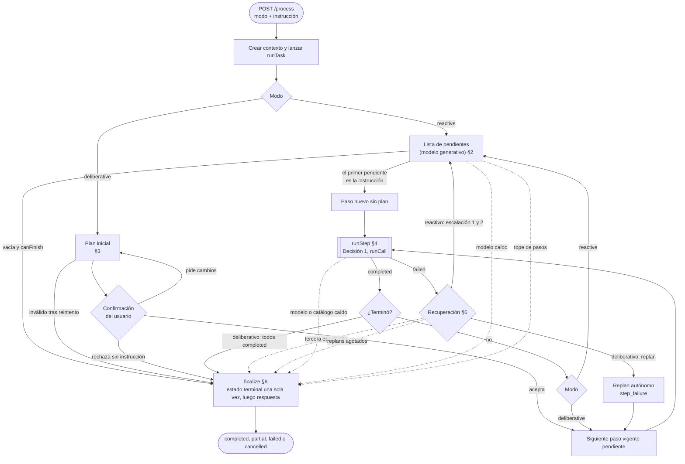
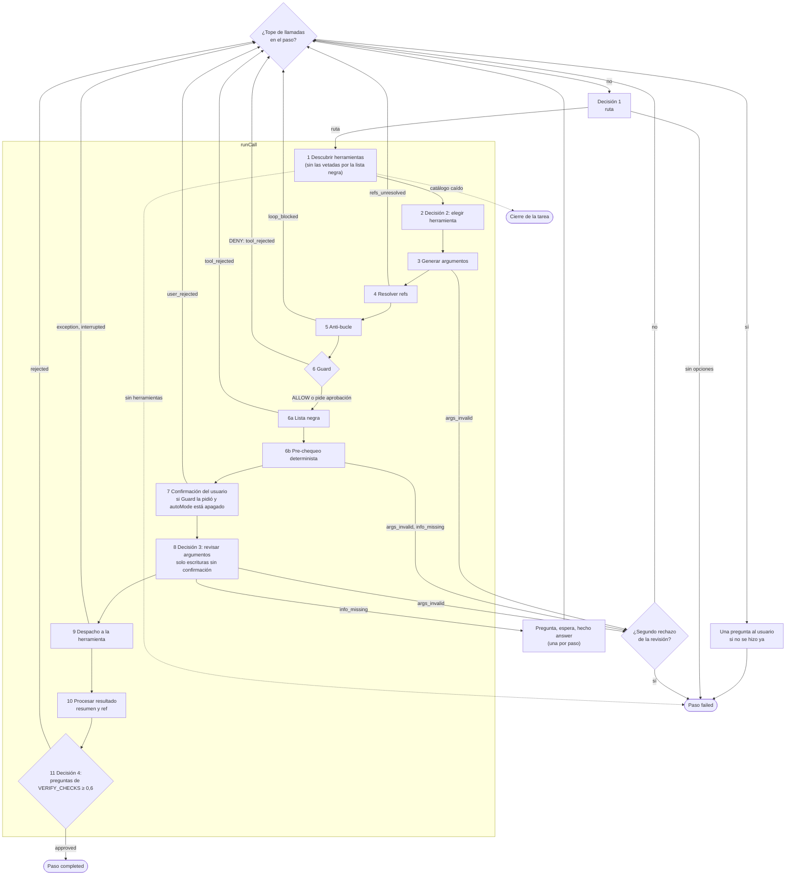

# Flujo de Ejecución y Orquestación

## 1. Ciclo de Vida
1. **Recepción**: la instrucción entra por `/process` con un modo (`reactive` o `deliberative`). La fachada crea el contexto de la tarea, lo registra y lanza `runTask` en segundo plano.
2. **Estrategia**: `runTask` ejecuta el modo elegido (§2 y §3). Es el único que decide cuándo y cómo se cierra la tarea.
3. **Ejecución por pasos**: cada paso consulta el destino (Decisión 1) y ejecuta llamadas (§4) hasta que una queda aprobada o el paso falla.
4. **Recuperación**: un paso fallido dispara la recuperación del modo: escalación en reactivo, replan en deliberativo (§6).
5. **Cierre**: `finalize` escribe el estado terminal una sola vez y, después, la respuesta final (§8).

**Arranque del servidor** (`server.ts`): además de los servidores MCP, `warmUpModels` (`models/warmup.ts`) hace una consulta mínima al modelo de decisión y al generativo (sin bloquear el arranque; un fallo solo se registra) y cada consulta a Ollama lleva `keep_alive` (`modelKeepAlive`, por defecto `30m`; `-1` = sin límite). Así la primera tarea tras una pausa no paga la carga en frío. Con las variantes sin proyector de visión (`docs/OLLAMA_MODELOS_TEXTO.md`) los dos modelos quedan residentes en 8 GB y cambiar de uno a otro cuesta 20 a 80 ms en lugar de ~1 s.

### Mapa del flujo
Las flechas punteadas son los cierres de la tarea; todos pasan por `finalize` (§8). Los números de las cajas remiten a las secciones.

### Dentro de un paso
`runStep` (§4) elige el destino y `runCall` (§5) recorre las fases de la llamada. Cada rama de error vuelve al inicio del paso con lo ocurrido a la vista del modelo, salvo las marcadas como cierre o como falla del paso.

## 2. Modo Reactivo
Cada vuelta del bucle toma el primer ítem de la **lista de pendientes** y crea un paso nuevo, sin plan previo.

- **Hilo con la tarea anterior** (`engine/thread.ts`, `detectContinuation` en `engine/classify.ts`): `TaskManager` guarda en RAM la última tarea `completed` con respuesta del modelo (pedido y 500 caracteres de la respuesta) durante 10 minutos. Al empezar una tarea reactiva con tarea anterior vigente, una consulta `noul` al modelo de decisión (`follow`, etapa `continuation`) pregunta si el pedido nuevo depende de ella; con `CONTINUATION_APPROVE` (0,3; medido 28 de 28 seguimientos y 0 de 28 falsos) la tarea anterior entra al prompt de `pending` y de la respuesta final (bloque `PREVIOUS TASK`), a la generación de argumentos (líneas `previous request/answer` del bloque `MEMORY`) y es fuente del pre-chequeo. Con hilo, una acción no toma el atajo de D0: `pending` reescribe el pedido («guardalo…») con la tarea anterior a la vista. Sin tarea anterior vigente, sin `continuation` o con la consulta fallida: nada cambia.
- **D0, primera consulta** (`engine/classify.ts`, reglas en `engine/firstQuery.ts`): antes de la lista de pendientes, una consulta al modelo de decisión (`d3:2b`, unos 50 ms; etapa `first_query` en la traza) con dos preguntas sobre la solicitud (`kind`: `chat` / `single` / `multi`, y `multi`: `noul`). **Charla** (`chat` ≥ 0,7): la tarea cierra `completed` sin llamadas y la respuesta final contesta (se saltea `pending`). **Una acción**: la lista es la solicitud literal y el paso la recibe sin reescritura. **Varias acciones** (`multi` ≥ 0,5), o D0 no disponible (sin `firstQuery`, consulta fallida, tarea ya empezada): el flujo de siempre. Es una optimización, nunca una condición. Medido con `eval/datasets/D0/`: 31 de 35, ningún falso «charla».
- **Lista de pendientes**: una consulta aparte al modelo generativo (sin razonamiento extendido) devuelve la lista completa de lo que falta para cumplir la solicitud. Recibe la solicitud, la lista de la vuelta anterior, lo hecho (con argumentos y resumen del resultado), los últimos intentos fallidos con su motivo y la entrada del usuario. La lista vive solo en el bucle; en el contexto entra únicamente la instrucción del paso. **La mantiene el código** (`pendingList.ts`): el modelo la genera al empezar, el paso que termina bien quita su ítem sin consultar, y solo se vuelve a consultar al modelo tras un paso fallido (para reescribir el ítem) o al vaciarse la lista (para confirmar que no falta nada). `reconcileList` evita que el modelo vuelva a agregar ítems ya cumplidos o abandonados y conserva los que venían detrás del reescrito. **Cierre con Decisión 5** (`engine/completion.ts`): cuando el último ítem termina bien (lista vacía, nada abandonado, `canFinish() = completed`), antes de confirmar con el LLM se le hace una pregunta `noul` (`request_complete`) al modelo de decisión, con la misma vista de `forPending` y la lista vacía (solicitud y todo lo hecho). Si la probabilidad llega a `COMPLETION_APPROVE` (0,75: más estricto que `NOUL_APPROVE`, porque un falso «sí» cierra la tarea incompleta en silencio) la tarea cierra `completed` sin llamar al LLM de pendientes; si no, o si el servicio falla, se confirma con el LLM como antes.
- **Salida parcial**: un ítem con `maxItemFailures` (2) pasos fallidos seguidos se abandona si quedan otros; se ejecutan los restantes (p. ej. guardar lo obtenido) y la tarea cierra `no_alternatives` (`partial`), con lo no logrado en el encabezado de la respuesta final.
- **Instrucción del paso**: el primer pendiente. Decisión 1, 2, 3 y 4 y la generación de argumentos ven esa instrucción, no la solicitud completa. **Excepción: Decisión 1 en reactivo** recibe también la línea `Request:` (la solicitud, recortada a `caps.routeRequest`), porque el primer pendiente suele perder lo que el usuario dijo sobre dónde o cómo hacerlo («ejecutá en la terminal: …»); su pregunta es «Where should this step run?» más la regla de seguir lo que el paso diga sobre dónde o cómo hacerlo.
- **Lista vacía**: significa que no queda nada por hacer y cierra la tarea según `canFinish`: `completed` si no hay llamadas o alguna está aprobada; `no_alternatives` si solo hubo rechazos del usuario. Sin llamadas (primera vuelta) o con solo fallos, una lista vacía no se acepta de inmediato: se consulta una vez más. Si en la primera vuelta vuelve vacía se acepta (la solicitud no necesita herramientas); si solo hubo fallos, la instrucción pasa a ser la solicitud entera.
- **Lista inválida**: un reintento y, si persiste, la tarea se cierra con `unrecoverable`.
- **Tope de pasos**: al llegar a `maxSteps` pasos (los fallidos cuentan) la tarea se cierra con `max_steps`.
- **Escalación**: un paso fallido es una escalación. Al tercero, la tarea se cierra con `no_alternatives`.

## 3. Modo Deliberativo
1. **Plan inicial**: el modelo generativo propone pasos (hasta el tope), cada uno con instrucción, ruta y resultado esperado. Un plan inválido tras el reintento cierra la tarea con `unrecoverable`.
2. **Confirmación humana**: la tarea espera la decisión del usuario.
   - *Aceptar*: se ejecutan los pasos.
   - *Pedir cambios* (con instrucción): se genera un plan nuevo (`user_feedback`), sin tope de veces, y se vuelve a pedir confirmación. Si el plan nuevo resulta inválido, se conserva el vigente y se vuelve a preguntar.
   - *Rechazar sin instrucción*: la tarea se cancela.
3. **Ejecución**: se toma el paso vigente pendiente y se corre con su ruta fija. La tarea se completa cuando todos los pasos vigentes quedan `completed`.
4. **Replan autónomo**: un paso fallido genera un plan nuevo (`step_failure`) sin pedir confirmación, hasta `maxReplans` veces. Los pasos no completados pasan a `superseded` y se agregan los nuevos; los completados nunca se repiten. El tope de pasos del plan nuevo es `maxSteps` menos los ya completados. Agotados los replans, o si el replan es inválido, la tarea se cierra con `replans_exhausted`.

## 4. Un Paso (`runStep`)
El paso repite este ciclo hasta que termina:

1. **Topes del paso** (`engine/limits.ts`, un solo punto de control `checkStepLimits`, al inicio de cada vuelta): si el paso alcanzó algún tope, falla con su causa (`repeat_blocked`, `user_rejected`, `denied`, `review_rejected` o `call_cap`, en ese orden de precedencia). Con los topes de ejecuciones (`maxCallsPerStep`) o de intentos (`maxAttemptsPerStep`), antes de fallar se le hace una pregunta al usuario, si todavía no se le hizo una en el paso; el paso falla igual y la respuesta queda a la vista de lo que siga (siguiente paso o replan). Una **ejecución** es una llamada que llegó a la herramienta; un **intento** es cualquier llamada registrada salvo `user_rejected` (incluye las bloqueadas y las de argumentos inválidos, que no gastan ejecuciones).
2. **Decisión 1**: en ambos modos. Ofrece las rutas con alguna herramienta utilizable (en deliberativo, solo la ruta del paso). Una ruta cuyos resultados Decisión 4 rechazó 2 veces como "no cumple lo pedido" (`not_accomplished`) en el paso (`maxNotAccomplishedPerRoute`) deja de ofrecerse en ese paso: cambiar los argumentos de la misma herramienta no resuelve lo que la ruta no puede dar; si no quedara otra, se ofrecen todas. La ruta cuyo último intento falló se marca en el prompt de D1. **En debate**: otro mecanismo para el reintento (cortar el paso tras un reintento fallido en lugar de quitar la opción). Si no queda ninguna opción, el paso falla (`no_tools`). Con una sola opción disponible, el modelo de decisión no se consulta.
3. **Llamada** (§5): si queda aprobada, el paso termina `completed`. Si el servidor deniega la herramienta (`denied`), el modelo ve el motivo y sigue, hasta `maxDeniedPerStep`. Una revisión que detecta `info_missing` hace una pregunta al usuario (una por paso): se genera con el modelo generativo, se espera la respuesta y se registra como hecho `answer_<paso>_<n>`. Una llamada bloqueada por el anti-bucle contra una llamada idéntica que la verificación ya aprobó da el paso por cumplido (`completed`: lo pedido ya está hecho); el segundo bloqueo del paso lo falla (`repeat_blocked`, `maxRepeatsPerStep`). El segundo rechazo del usuario en un paso también lo falla (`user_rejected`, `maxUserRejectionsPerStep`): la instrucción del usuario queda a la vista del reintento o del replan. Cualquier otro resultado (argumentos inválidos, referencias sin resolver, anti-bucle, revisión rechazada, rechazo del usuario o verificación rechazada) vuelve al inicio con lo ocurrido a la vista del modelo.
4. **Rechazos de la revisión**: al segundo `args_invalid` (el pre-chequeo y D3 lo producen; `tool_rejected` ya no se ofrece) en el mismo paso, el paso falla (`review_rejected`) y la recuperación del modo lo reencauza.

`ask_user` no es una opción de las decisiones: solo se pregunta en los dos casos de arriba (`info_missing` y tope de llamadas).

## 5. Una Llamada (`runCall`)
Fases en orden. Cada llamada se registra una sola vez, al terminar el intento, con su estado final.

| # | Fase | Qué ocurre si falla |
|---|---|---|
| 1 | **Descubrir** las herramientas del destino | Servidor o catálogo no disponible: se registra el error y la tarea se cierra (`unrecoverable`). Sin ninguna herramienta utilizable en ese momento, el paso falla (`no_tools`) |
| 2 | **Elegir herramienta** (Decisión 2). Solo se ofrecen las herramientas utilizables: las que dependen de un proceso activo o de una búsqueda iniciada aparecen solo mientras existan. Van en el orden del catálogo (`sortByCatalog`), no en el del descubrimiento del servidor | — |
| 3 | **Generar argumentos** (modelo generativo, conforme al esquema). El prompt incluye, además de `FAIL` (fallos del paso), la sección `LAST ERROR`: el último intento ejecutado de esa misma herramienta que falló (error de la herramienta o resultado rechazado por la verificación), de cualquier paso, con los argumentos que se probaron y lo que devolvió, para que no los repita y corrija solo la causa. No aparece si una llamada posterior de esa herramienta quedó aprobada ni si ese intento ya está en `FAIL`. `EFFECTS` (y el de la respuesta final y el del plan) muestra el resultado de cada llamada con sus saltos de línea y sin recorte (`effectEntry`): en una sola línea las tablas de salida de un comando llegaban aplastadas y el modelo cortaba o convertía mal las cifras. Se agrega aunque la escritura ya figure en `EFFECTS`; en ese caso `EFFECTS` la muestra en una línea (llamada y argumentos, `result: see LAST ERROR`), para no repetir el resultado. Para acotar el prompt en los reintentos, solo las 2 últimas llamadas de `EFFECTS` y de `FAIL` llevan el texto de su resultado (las anteriores, solo llamada y argumentos; ningún efecto se omite) y los fallos con la misma herramienta, estado y argumentos se juntan en una línea con `×N`. La temperatura sube con los intentos previos de la herramienta en el paso sin aprobar: 0,1 el primero, 0,3 el segundo, 0,5 desde el tercero | Salida inválida tras el reintento: `args_invalid` |
| 4 | **Resolver referencias** `{{ref:rN}}` / `ref:rN` por su contenido en disco | Referencia desconocida: `refs_unresolved` |
| 5 | **Anti-bucle** sobre la huella de los argumentos resueltos, con la política de repetición de la herramienta (ver «Anti-bucle» abajo) | Repetición bloqueada: `loop_blocked` |
| 6 | **Guard** | `DENY`: no se ejecuta; queda `tool_rejected` con el motivo (en inglés) y el modelo prueba otro camino. La tarea no cierra: al tope `maxDeniedPerStep` (2: Guard, lista negra o servidor) falla el paso |
| 6a | **Lista negra** (`policy/blacklist.ts`): dos fuentes, y gana el nivel más grave. (1) Las **reglas de comando integradas** (`policy/commandRules.ts`, siempre activas): analizan el comando y la ruta juntos, en Windows y Linux (borrados, apagado, discos, usuarios, registro, procesos y servicios, git, paquetes, mover y escribir archivos, descargar y ejecutar). (2) Las entradas de `blacklist` en `jarvis-config.json`, por herramienta y con patrón opcional. Dos niveles: `blocked` (muy destructivo) y `sensitive` (riesgoso pero a veces legítimo). Solo escrituras; las lecturas nunca se miran. Una herramienta vetada entera no se ofrece en la Decisión 2. **Con `autoMode` apagado, cualquier coincidencia se pregunta al usuario** (paso 7). Con `autoMode` encendido: `blocked` se rechaza aquí; `sensitive` sigue a D3 con umbral estricto | `tool_rejected` (solo `blocked` en automático), con la razón escrita; el modelo sigue con otra herramienta u otros argumentos (no cierra la tarea, a diferencia de Guard) |
| 6b | **Pre-chequeo determinista** (código, sin modelo; `engine/precheck.ts`; también **la carpeta contenedora de `write_file` y `move_file`**: si no existe en el disco la herramienta falla con `ENOENT`, así que se rechaza con la razón «crear la carpeta primero con `create_directory`» (solo con rutas absolutas y si la carpeta de inicio del entorno existe en esta PC); y **el destino de una escritura**: una ruta absoluta fuera de las carpetas del usuario que ni ella ni uno de sus ancestros aparece en el pedido o en lo ya hecho se rechaza, 2026-11-14): valores vacíos o `N/A`, marcadores de posición, rutas de otro usuario o de Linux, comandos que no existen en el sistema o con error de sintaxis (parser de PowerShell; también el texto interior de `powershell -Command "…"`, que además se rechaza por innecesario: el shell ya es PowerShell), rutas de lectura y URLs que no aparecen en nada de lo que la tarea sabe. Ante la duda no rechaza | `args_invalid` o `info_missing`, con la razón escrita como resumen (llega a la línea FAIL del LLM de argumentos) |
| 7 | **Confirmación del usuario**, si Guard pidió aprobación y el modo automático (`autoMode`) está apagado, o si la llamada coincidió con la lista negra y `autoMode` está apagado (el motivo mostrado es el de la regla), después del pre-chequeo (no se le pide aprobar lo que ya se sabe inválido). No se registra nada mientras se espera. **Si el usuario aprueba, la llamada se da por revisada: Decisión 3 no entra**. Excepción: un `run_command { pid, input }` cuyo `input` es exactamente lo que el usuario respondió en este paso a la pregunta de ESE proceso, y que todavía no se envió, no pide confirmación ni pasa por D3 (el texto ya lo escribió el usuario; cada respuesta autoriza un envío; no vale con una ruta sensible ni con la lista negra) | Rechazo: `user_rejected`, con la instrucción opcional del usuario |
| 8 | **Revisar argumentos**, con umbral (`REVIEW_APPROVE` = 0,6 en `engine/verify.ts`: aprueba solo si la probabilidad de `approved` llega a 0,6; si no, rechaza con la opción de rechazo más probable), solo en escrituras a las que no se les pidió confirmación (`kind: write` sin aprobación de Guard o con el modo automático encendido; las lecturas pasan por el pre-chequeo) (Decisión 3; opciones `approved`, `args_invalid` e `info_missing`: no hay `tool_rejected`, la herramienta la elige Decisión 2) | `args_invalid` (con un motivo fijo: el modelo de decisión solo elige la opción; los argumentos rechazados no se muestran en `FAIL`) o `info_missing`. Con el umbral estricto (regla `sensitive`), si habría pasado con el umbral normal: `tool_rejected` |
| 9 | **Despacho** a la herramienta, compitiendo contra la cancelación. El proveedor recibe `ToolCallOptions` (`tools/provider.ts`): la señal de cancelación, el plazo del manifiesto (`timeoutMs`), la tarea (`taskId`) y, si declara dependencias, un `ToolHost` (`tools/host.ts`) que solo deja llamar a lo declarado y deja cada sub-llamada en la traza. `run_command` lanza PowerShell con la salida en UTF-8 (`src/tools/terminal/`); el contexto y la traza guardan el comando tal cual | Excepción: `exception`. Cancelación: `interrupted`, y un resultado tardío se descarta |
| 10 | **Procesar el resultado**: estado, resumen acotado y, si el resumen no contiene todo, el texto completo va a una ref en disco | — |
| 11 | **Verificar** (Decisión 4, §7) | Rechazada: vuelve al paso con el motivo |

### Anti-bucle (`ctx/derive.ts`, `isRepeat`)
Compara la llamada propuesta (herramienta y huella de los argumentos resueltos) con la llamada **ejecutada** idéntica más reciente de la tarea; las `loop_blocked` no dejan rastro. Primero el orden: una lectura idéntica se bloquea salvo que haya habido una escritura exitosa en el medio, una escritura idéntica salvo una lectura ejecutada en el medio, y una respuesta del usuario habilita repetir ambas. Después, solo para **lecturas**, lo ocurrido con la anterior decide:

| La lectura anterior… | Repetirla |
|---|---|
| fue **aprobada** por la verificación | se bloquea en toda la tarea (el dato ya está a la vista; repetirla cierra el paso como cumplido) |
| fue **rechazada** por la verificación (`ok` pero no sirvió) | se bloquea dentro de su paso y en pasos con el **mismo criterio** (misma instrucción y mismo esperado: el reactivo reintenta un ítem con un paso nuevo); se permite en un paso con otro criterio |
| falló por algo **pasajero** (`tool_error`, `exception`, `interrupted`) | se permite **un** reintento idéntico por paso; en otro paso, siempre |
| terminó en `no_data` o `not_found` | `strict`: se bloquea (no cambiará sola); `retry_failed`: un reintento por paso |
| fue `denied` por el servidor | se bloquea |

Una escritura idéntica no se relaja (pudo dejar cambios parciales), salvo con la política `rerun`: `run_command` la declara para comandos de comprobación o compilación que `policy/rerun.ts` reconoce (`npm test`, `dotnet build`), y entonces se repite si hubo un efecto en el medio. La política sale del catálogo (`repeat` de cada herramienta): `strict` (por defecto), `retry_failed` (`web_search` y las internas de Free Search `search`, `read_doc`, `research` y `fetch`: su resultado puede cambiar entre dos llamadas iguales) y `allow` (`run_command`, que repite los mismos argumentos al esperar más salida de un `pid`, y el sondeo `get_more_search_results`).

### Aprobación por niveles (`approvalTiers`, opt-in)
Con `approvalTiers: true` en `jarvis-config.json` (por defecto **apagada**: el comportamiento de `autoMode` no cambia) la aprobación de las escrituras la decide el código por nivel (`policy/tiers.ts`) en lugar del `autoMode` binario:

| Nivel | Qué es | Confirmación | Decisión 3 |
|---|---|---|---|
| **Verde** | Reversible y sin sobrescribir dentro de las carpetas del usuario: crear una carpeta, escribir un archivo que no existe (con la carpeta contenedora existente), mover a un destino que no existe (idem) | No | No (la poscondición se comprueba en el disco, §7) |
| **Amarillo** | Agregar a un archivo (`mode: append`), escribir fuera de las carpetas del usuario, rutas relativas o sin ruta, herramientas del catálogo sin clasificar | No | Sí, con umbral estricto (`BUDGET.sensitiveApprove`) |
| **Rojo** | Sobrescribir un archivo que existe, pisar un destino, `run_command` que modifica, `stop_process`, herramienta no catalogada, lo obligatorio de Guard (ruta o dato sensible) y toda coincidencia de la lista negra | **Siempre el usuario** | No (la aprobación es la revisión) |

Lo que ya rechazaba (`DENY` de Guard, `blocked` de la lista negra) sigue rechazando. Las lecturas no pasan por niveles. Sin la «lista de permitidos» ni «no volver a preguntar lo mismo» tras un rechazo del usuario (sin hacer).

### Modo automático (`autoMode`)
Se lee en cada llamada (`deps.autoMode()`, `callRunner.ts`) y cambia solo dos fases de §5; el resto del flujo es igual. Una **ruta sensible** (`policy/sensitivePaths.ts`) pide confirmación obligatoria también con `autoMode` (`GuardDecision.mandatory`).

| Fase | `autoMode` apagado | `autoMode` encendido |
|---|---|---|
| 7 Confirmación del usuario | Si Guard pide aprobación (toda escritura o comando del catálogo: `write_file`, `create_directory`, `move_file`, `run_command`; salvo un `run_command` que `policy/readOnly.ts` demuestra de solo lectura, o que solo espera más salida de un `pid`). Además, `policy/egress.ts` exige confirmación obligatoria, también con `autoMode`, si la consulta de `web_search` lleva claves, tokens o rutas del usuario, la tarea espera la decisión | No se pide para herramientas del catálogo. Una herramienta no catalogada sigue pidiéndola |
| 6a Lista negra | Toda coincidencia (`blocked` o `sensitive`) se pregunta al usuario | `blocked` se rechaza (`tool_rejected`); `sensitive` pasa a D3 con umbral estricto |
| 8 Decisión 3 | Solo corre si no hubo confirmación (en la práctica, nunca para esas herramientas) | Corre en toda escritura o comando del catálogo, con el umbral `REVIEW_APPROVE` (0,6); si coincidió con una regla `sensitive`, con el umbral estricto `sensitiveApprove` (0,65) |

No cambian: Guard (`DENY` rechaza la llamada sin cerrar la tarea, regla B de carpetas protegidas, herramienta no catalogada → aprobación), la lista negra (6a), el pre-chequeo (6b), la verificación (D4) ni las lecturas (nunca pasan por D3). Con `autoMode` encendido la última barrera antes de ejecutar una escritura es D3, un modelo de 2B; D4 actúa después de ejecutar y no deshace nada.

Cobertura real de esas barreras (revisada en el código):
- Guard deniega la llamada con los patrones `DENY` (`rm -rf /…`, `mkfs`, `format c:`, `/etc/shadow`, `system32/drivers`) y con el nivel `guard` de `commandRules.ts` (discos y raíz del sistema: `Format-Volume`, `diskpart`, borrar una raíz de unidad o `C:\Windows`, `dd` a un dispositivo, fork bomb), en cualquier modo: no se ejecuta, queda como `tool_rejected` (no cierra la tarea) y al tope `maxDeniedPerStep` (2) falla el paso.
- Las reglas integradas de `commandRules.ts` (siempre activas, aunque `blacklist` esté vacía) cubren los comandos destructivos y de administración de Windows y Linux: `Remove-Item -Recurse` sobre carpetas críticas o de usuario, `Stop-Computer`/`Restart-Computer`, `reg delete`, `Set-ExecutionPolicy`, cuentas de usuario, `taskkill`, servicios, `git reset --hard`/`push --force`, instalaciones, `Set-Content` y redirecciones. Desde la v0.6.0 también: borrar `Documents`, `Desktop`, `Downloads` u otra carpeta personal entera o todo su contenido (`blocked`), y como `sensitive` los cambios de Defender, firewall, red y energía (`Set-MpPreference`, `netsh advfirewall`, `Set-Service`, `powercfg`), las descargas a disco (`Invoke-WebRequest -OutFile`, `curl -o`, `certutil`, `bitsadmin`) y los lanzadores indirectos (`mshta`, `rundll32`), las tareas programadas y la ejecución remota (`Register-ScheduledTask`, `Invoke-Command`, `Enable-PSRemoting`), la elevación (`Start-Process -Verb RunAs`), el borrado de registros (`wevtutil cl`, `Clear-EventLog`, `Clear-RecycleBin`), WMI/CIM (`Remove-WmiObject`, `Invoke-CimMethod`) y las llamadas .NET estáticas a archivos (`[IO.File]::Delete`, `[IO.Directory]::Delete`). Resuelven alias, `cmd /c`, `powershell -Command`/`-EncodedCommand` y variables como `$env:USERPROFILE`. **Límites**: no es una barrera contra un atacante sino contra el error de un modelo chico; no resuelve variables definidas por el mismo comando, rutas que vienen de una tubería ni comandos armados por concatenación, y de .NET solo reconoce las llamadas estáticas a `[IO.File]`/`[IO.Directory]` (no, por ejemplo, `(Get-Item x).Delete()`).
- `blacklist` (config) viene vacía: solo agrega las entradas propias del usuario.
- `run_command` es una escritura por catálogo, pero un comando nuevo que `policy/readOnly.ts` demuestra de solo lectura (cada segmento de una lista cerrada de cmdlets de consulta, sin redirecciones, llamadas, subexpresiones, métodos ni variables, y sin que lo marque ninguna regla de comando) se registra como `read`: su salida va a DATA, no pide confirmación y no pasa por D3. Todo lo que no reconoce sigue como `write` (fail-closed). Continuar un proceso (`{ pid }`) sin `input` solo espera más salida y es una lectura; con `input` (la respuesta a un proceso que esperaba entrada) es una escritura.

## 6. Recuperación y Dudas
- **Reactivo**: tras un paso fallido, la lista de pendientes se regenera viendo los fallos con sus argumentos y puede reescribir la instrucción. Decisión 1 y 2 ven solo los intentos del paso actual (la línea de cada uno y, solo si explica el fallo —`tool_error`, `exception`, `args_invalid`, `info_missing`, `tool_rejected`, `user_rejected`—, su resumen recortado a `caps.attemptSummary`; el resultado leído de una llamada que la verificación rechazó no se repite); los de pasos anteriores los ve la lista. Una herramienta cuya llamada se bloqueó por repetición sigue ofrecida: el anti-bucle solo bloquea la llamada idéntica (misma herramienta y huella de argumentos) y compara contra toda la tarea; dos bloqueos en el paso lo fallan (`repeat_blocked`).
- **Deliberativo**: replan autónomo (§3).
- **Información faltante**: la revisión detecta `info_missing`, la llamada se registra con ese estado y se pregunta al usuario, una vez por paso. También se pregunta antes de fallar por tope de llamadas.
- **Seguridad**: una denegación de Guard no cierra la tarea: queda `tool_rejected` y el modelo prueba otro camino (si insiste y agota `maxDeniedPerStep`, falla el paso y se activa la recuperación del modo). Un rechazo del usuario sobre una operación no cierra la tarea: queda como `user_rejected` y el flujo continúa.

## 7. Verificación del Resultado
Decisión 4 evalúa las preguntas `noul` de la tabla `VERIFY_CHECKS` (`contracts.ts`) sobre cada llamada ejecutada: `ok` (¿la llamada tuvo éxito y trajo datos utilizables?) y `cumple` (¿el resultado satisface la instrucción del paso?). El criterio es siempre el paso: en reactivo, el primer pendiente.

- Aprueba solo si pasan todas, cada una con probabilidad de al menos 0,6 (`NOUL_APPROVE` en `engine/verify.ts`, `verdictOf`).
- La razón es la de la primera pregunta que falla, en el orden de la tabla: si falla `ok`, `no_usable_data`; si falla solo `cumple`, `not_accomplished`.
- **Primero el código (N5, 2026-11-14):** antes de consultar a Decisión 4 (`verifyCall`, `engine/postcondition.ts`): (a) `tool_error`, `exception` y `no_data` se rechazan sin modelo; (b) una **escritura del catálogo** con estado `ok` se comprueba en el disco: `create_directory` → la carpeta existe, `move_file` → el origen ya no está y el destino sí, `write_file` → el archivo existe y no está vacío si se pidió texto; cumplida, pasa por las **sondas** de la herramienta (ver abajo); no cumplida se rechaza (`not_accomplished`) sin modelo; una ruta relativa o una herramienta distinta no se comprueban y decide el modelo; (c) en una **lectura determinista con contenido** (`list_directory`, `read_file`, `read_multiple_files`, `list_processes`, estado `ok`, resumen no vacío ni «Directorio vacío.») la pregunta `ok` la responde el código (`VerifyDecisionInput.known`) y al modelo solo se le hace `cumple`. Con D4 aplicada así a los datasets `d4/` del laboratorio: 141/184 → 145/184, 0 regresiones. Búsquedas y salida de comandos siguen con ambas preguntas.
- **Sondas por herramienta (2026-11-14, `tools/probes.ts` + `engine/probes.ts`):** el `cumple` genérico de D4 no ve los fallos que son una incoherencia entre lo pedido y un argumento de la llamada, ni una propiedad que la herramienta no devuelve. Cada herramienta declara sus sondas en el catálogo (`probes` en `tools/manifest.ts`; `probesOf`): `write_file` → ubicación + posición, `create_directory` y `move_file` → ubicación, `read_file` de `.xlsx`/`.xls`/`.xlsm` → ítem (hoja), `start_search` por nombre → alcance, `list_directory` → atributo (compuerta + resultado). Aplican por herramienta y tipo de archivo, nunca por palabras del pedido. Tras un veredicto base aprobado (postcondición cumplida, lectura conocida o `cumple`), `runProbes` hace las consultas `noul` en orden (`Decision.probe`, etapa `probe`): una consulta con compuerta por debajo de 0,6 deja la sonda sin aplicar; en las demás el valor de «bien» (o su complemento con `badWhenTrue`) debe llegar al umbral de la sonda (0,6): **dudar es rechazar**. La primera que falla rechaza la llamada con su motivo cerrado (`wrong_place`, `wrong_position`, `wrong_scope`, `wrong_item`, `missing_attribute`), cuyo texto fijo (`REASON_NOTES`) llega a `FAIL` del generador; el paso reintenta y `maxVerifyRejectionsPerStep` (2) lo corta. Medido con criterios y casos parecidos a producción (`eval/exp/probe_eval.ts`, 52 casos): 0 buenas rechazadas y 30 de 34 malas rechazadas a 0,6 (`docs/analisis/PREGUNTAS_DECISION.md`). Lo que una escritura rechazada por `wrong_place` dejó en el disco se avisa por código en la respuesta final (`renderPlaceNote`, con y sin modelo): «Quedó escrito en X… no coincide con el lugar que pediste»; no se mueve ni se borra nada.
- **Cierre con Decisión 5 segura de que falta algo (2026-11-14):** si la probabilidad de `request_complete` es menor que `COMPLETION_INCOMPLETE_BELOW` (0,25) y la lista de pendientes que propone el modelo queda vacía solo porque `reconcileList` la descartó por parecerse a un ítem ya cumplido (p. ej. un ítem compuesto «crear la carpeta y luego el archivo» del que solo se hizo la primera parte), la tarea no cierra: se ejecutan los ítems propuestos que no repiten el texto exacto de uno ya cumplido, hasta 2 veces por tarea (`runReactive`). Visto en una traza real del 14/11: la tarea terminó `completed` sin crear el archivo.
- **Tope por rechazos de D4 (2026-11-14):** `maxVerifyRejectionsPerStep` = 2. Con dos llamadas rechazadas por la verificación en el mismo paso, el paso falla con `verify_rejected` y la recuperación del modo reescribe el ítem (reactivo: `pending` → D1) o replanifica (deliberativo). Un solo reintento por paso.
- `tool_error` y `exception` se rechazan sin consultar al modelo. `interrupted`, `waiting_input` y `denied` no se verifican y quedan sin veredicto. Con `waiting_input` (un proceso de `run_command` que pide una respuesta) el bucle de paso pregunta al usuario con `askUser`, con el prompt del proceso como pregunta (sin modelo), y sigue: la respuesta vuelve en la llamada siguiente. La respuesta se guarda en `answer_<paso>_<n>_p<pid>`: la clave ata la respuesta al proceso que preguntó (los modelos ven el texto, nunca la clave). Las preguntas de procesos tienen su propio tope (`maxProcessPromptsPerStep`, 3) y no gastan la del modelo (`maxQuestionsPerStep`, 1); se distinguen por esa clave.
- Una respuesta inválida se repite una vez; si persiste, el servicio se considera no disponible.
- **Argumentos: la solicitud original (2026-11-14, solo reactivo).** La vista de argumentos lleva además una línea `REQUEST:` (la solicitud completa, recortada a `caps.routeRequest`) antes de `TASK:`, salvo que sea igual al paso. El primer pendiente puede perder el valor exacto que el usuario dio. En los datasets de argumentos del laboratorio (3 repeticiones, junto con el cambio del pre-chequeo): 309/345 → 323/345, ningún dataset empeoró.
- **Argumentos: memoria y reglas de comando.** Las reglas de PowerShell y la línea del sistema operativo van solo si la herramienta recibe `command` (`ARGUMENTS_VIEW.buildSystemPrompt`). Si hay hechos guardados del usuario (`data/memory.json`, `memory.ts`: pares `clave → valor` escritos a mano) cuya clave aparece completa en el pedido o en el paso (por prefijo de 5 letras, hasta 3), el prompt agrega el bloque `MEMORY`; sin coincidencia no hay bloque. Los valores de esos hechos también son fuente del pre-chequeo (`collectSources(ctx, extra)`): sin eso, una ruta que viene de un hecho se rechazaría como inventada.
- **Memoria por tarea de las decisiones** (`memoizeDecision`, `engine/env.ts`): una misma entrada de D0 a D5 dentro de una tarea devuelve la misma respuesta sin volver a consultar al modelo; un fallo no se guarda. Las consultas de decisión no se repiten por respuesta inválida (el decisor es determinista).
- **Llamadas previas (`recent`)**: `forVerify` entrega además las llamadas aprobadas anteriores a la evaluada, completas (argumentos y resumen), en ambos modos (`VerifyView.previous`). `verifyInput` (`engine/adapters.ts`) se queda con las últimas `caps.lastReads` (3) como `VerifyDecisionInput.recent`. `buildResultVerification` (`models/prompts.ts`) **ya no lo agrega al prompt** (Frente 2, DN-2.2: sin el bloque `Previous approved calls` mejoró 3 casos y empeoró 1, con menos tokens); `forVerify` y `verifyInput` siguen calculándolo.

## 8. Cierre y Respuesta Final
`finalize` escribe el estado terminal una sola vez y después la respuesta (`result`), con su origen:

- **`cancelled`**: siempre respuesta de respaldo, sin modelo.
- **Modelo generativo caído** (un fallo anterior ya lo marcó): respuesta de respaldo directa, sin consultarlo.
- **Resto de los cierres**: el modelo generativo redacta la respuesta con la vista final. Si la vista no entra en su reserva, o el modelo falla por cualquier causa, se entrega la respuesta de respaldo.

Si la tarea no dejó cambios en la computadora y el pedido no pregunta por cambios, el código quita de la respuesta la frase de relleno «No se realizaron cambios en el sistema» (`engine/finalClean.ts`; cambiar la regla del prompt también lo lograba, pero bajaba el acierto de los datasets de `final`).

Cuando la tarea termina `partial` o `failed`, la respuesta del modelo va precedida de un **encabezado fijo** escrito por el código (`renderStatusNote`: estado, qué no se logró y cambios hechos en la computadora). El bloque `EFFECTS` dice "none" de forma explícita si no hubo cambios, y el prompt aclara que `read`/`write` junto a una herramienta es su tipo, no lo que hizo. Un `loop_blocked` muestra al modelo de argumentos los argumentos bloqueados y el mensaje pide cambiarlos; un rechazo con razón escrita oculta los argumentos.

La respuesta de respaldo es texto fijo, sin modelo: estado de la tarea, motivo de detención, fallos, cambios aplicados al entorno y últimas acciones. Su origen (`model` o `fallback`) queda registrado. El estado terminal nunca depende de cómo se redactó la respuesta.

**Después de la respuesta** (`runTask`): `DiscoveryEngine.notifyTaskEnd` avisa a cada proveedor cómo terminó la tarea (`completed`, `failed` o `cancelled`). Con `failed` o `cancelled`, `run_command` corta el árbol de los procesos que la tarea dejó corriendo; con `completed` los deja (pudo ser lo pedido). Luego `TaskManager` escribe la traza en segundo plano (la captura es inmediata; la escritura y la compresión son asíncronas y no bloquean el servidor).

**Cierre del servidor** (`server.ts`): se cancelan las tareas, `TaskManager.drain` espera hasta 3 s a que cierren sus procesos y escriban su traza, y recién entonces se apagan los servidores MCP (el apagado total tiene un tope de 5 s).

## 9. Estados y Transiciones

| Estado | Condición |
|---|---|
| `running` | La tarea está en curso, incluidas las esperas del usuario (plan, aprobación o pregunta). |
| `completed` | Reactivo: lista de pendientes vacía con `canFinish` en `completed`. Deliberativo: todos los pasos vigentes `completed`. No lleva motivo. |
| `partial` | Se detuvo por `max_steps`, `replans_exhausted`, `no_alternatives` o `unrecoverable`, pero hubo efectos sobre el entorno o al menos una llamada aprobada. |
| `failed` | Se detuvo por alguno de los motivos anteriores sin efectos ni llamadas aprobadas. |
| `cancelled` | El usuario canceló (`user_cancelled`), en cualquier momento. |

El motivo de detención es una lista cerrada: `max_steps`, `no_alternatives`, `security_denied` (histórico: para leer trazas anteriores; el motor ya no lo emite), `user_cancelled`, `replans_exhausted` y `unrecoverable` (falló un modelo o el catálogo de herramientas, o una vista no cupo en su límite; no la tarea en sí).

## 10. Errores y Límites
- **Transporte hacia modelos**: los fallos de red o HTTP 503 se reintentan una vez tras 1 s. El timeout y la cancelación nunca se reintentan.
- **Salidas inválidas o truncadas**: el modelo generativo reintenta una vez inyectando el motivo del error en el prompt; el modelo de decisión repite la consulta una vez. Si persiste: en argumentos es `args_invalid`; en la lista de pendientes, `unrecoverable`; en decisión y verificación, servicio no disponible.
- **Servicio no disponible**: se registra el error `service_unavailable` (si ya hay un paso) y la tarea se cierra con `unrecoverable`.
- **Desborde de contexto**: si un prompt no deja margen para la salida, o una vista no entra en su límite, la tarea se cierra con `unrecoverable` sin registrar error y sin repetir.
- **Cancelación cooperativa**: la señal de aborto llega a las esperas y a las llamadas en vuelo, y la tarea concluye sin tratarse como error. Una herramienta ya despachada queda `interrupted`.

Límites vigentes (definidos en `budget.ts` y `config.ts`; los timeouts y el contexto son valores por defecto):

| Límite | Valor |
|---|---|
| Pasos máximos (`maxSteps`) | 20 (reactivo: tope de la tarea; deliberativo: tope por plan) |
| Replans (`maxReplans`) | 3 |
| Escalaciones (reactivo) | 2 (la tercera cierra la tarea) |
| Ejecuciones por paso (`maxCallsPerStep`) | 6 (llamadas que llegaron a la herramienta) |
| Intentos por paso (`maxAttemptsPerStep`) | 10 (toda llamada registrada salvo los rechazos del usuario: techo contra un modelo que da vueltas) |
| Rechazos de la verificación que agotan una ruta (`maxNotAccomplishedPerRoute`) | 2 (por paso) |
| Bloqueos por repetición por paso (`maxRepeatsPerStep`) | 2 (el segundo falla el paso; si repetía una llamada ya aprobada, el paso se da por cumplido) |
| Rechazos de la revisión por paso (`maxReviewRejectionsPerStep`) | 2 (el segundo falla el paso) |
| Rechazos de la verificación por paso (`maxVerifyRejectionsPerStep`) | 2 (el segundo falla el paso con `verify_rejected`) |
| Denegaciones por paso (`maxDeniedPerStep`) | 2 (Guard o lista negra: `tool_rejected`; servidor: `denied`; la segunda falla el paso, no la tarea) |
| Rechazos del usuario por paso (`maxUserRejectionsPerStep`) | 2 (el segundo falla el paso: `user_rejected`; no cuentan como intentos ni como ejecuciones) |
| Preguntas al usuario por paso (`maxQuestionsPerStep`) | 1 (las que redacta el modelo) |
| Preguntas de procesos por paso (`maxProcessPromptsPerStep`) | 3 (lo que pide un proceso de `run_command`; no gastan la anterior) |
| Salida de la lista de pendientes (`pending.maxTokens`) | 1024 tokens |
| Reintentos de transporte | 1, tras 1 s |
| Reintentos por salida inválida (`invalidResponseRetries`) | 1 |
| Tareas retenidas | 20 |
| Timeouts | Modelo generativo 120 s (180 s con razonamiento extendido); modelo de decisión 30 s; herramientas MCP 60 s (las propias fijan su plazo en el catálogo: `run_command` 315 s, `web_search` 150 s) |
| Contexto configurado | 16 384 tokens para ambos modelos |

## 11. Invariantes del Flujo
1. **Unicidad de ejecución**: toda herramienta se ejecuta exclusivamente a través de `runCall` y detrás de Guard (ver `ARCHITECTURE.md`).
2. **Un solo cierre**: solo `runTask` decide el cierre; `runStep` y `runCall` nunca escriben el estado terminal ni la respuesta.
3. **Pasos completados inmutables**: un replan nunca repite ni reemplaza pasos `completed`.
4. **Efectos permanentes**: los efectos ya aplicados no se retiran ante desvíos posteriores (ver `CONTEXT_AND_MEMORY.md`).
5. **Estado terminal cerrado**: una vez terminal, ninguna respuesta demorada ni evento tardío modifica el estado; el contexto rechaza toda escritura posterior.

## 12. Archivos Base
| Tema | Ruta en `src/core/` |
|---|---|
| Entrada y estrategia | `tasks.ts`, `engine/runTask.ts`, `engine/stepLoop.ts`, `engine/planner.ts`, `engine/pending.ts` |
| Llamadas y verificación | `engine/callRunner.ts`, `engine/verify.ts`, `engine/ask.ts` |
| Cierre y fallos | `engine/finalize.ts`, `engine/failures.ts`, `engine/runtime.ts` |
| Modelos y transporte | `models/decision.ts`, `models/qwen.ts`, `models/prompts.ts`, `models/stageRequests.ts`, `models/transport.ts`, `budget.ts` |
| Etapas de modelo (ids de traza: `continuation`, `first_query`, `route`, `tool`, `review`, `verify`, `completion`, `args`, `question`, `plan`, `final`, `pending`) | `types/stages.ts` |
| D0, hilo y memoria | `engine/classify.ts`, `engine/firstQuery.ts`, `engine/thread.ts`, `memory.ts` |
| Limpieza de la respuesta final | `engine/finalClean.ts` |
| Seguridad | `policy/guard.ts`, `policy/readOnly.ts`, `policy/sensitivePaths.ts` |
