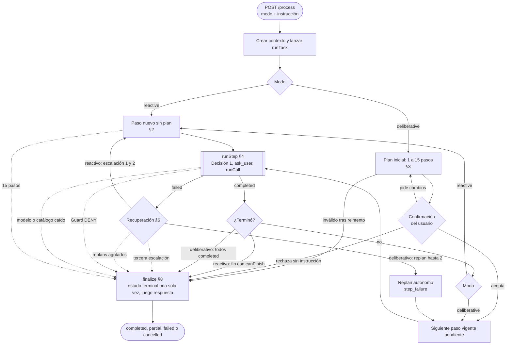
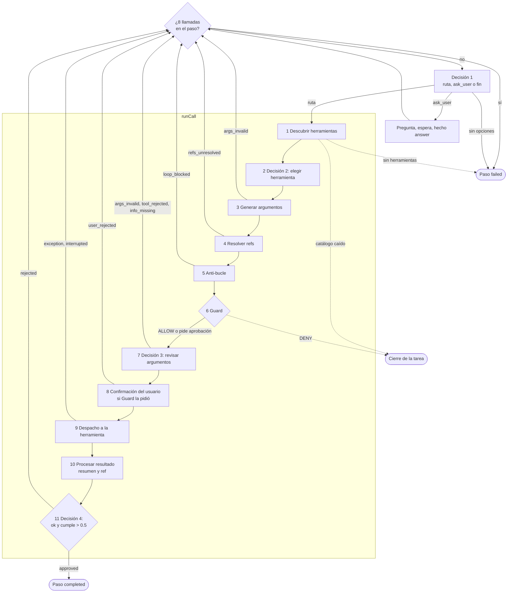

# Flujo de Ejecución y Orquestación

## 1. Ciclo de Vida
1. **Recepción**: la instrucción entra por `/process` con un modo (`reactive` o `deliberative`). La fachada crea el contexto de la tarea, lo registra y lanza `runTask` en segundo plano.
2. **Estrategia**: `runTask` ejecuta el modo elegido (§2 y §3). Es el único que decide cuándo y cómo se cierra la tarea.
3. **Ejecución por pasos**: cada paso consulta el destino (Decisión 1) y ejecuta llamadas (§4) hasta que una queda aprobada o se agota el tope de llamadas del paso.
4. **Recuperación**: un paso fallido dispara la recuperación del modo: escalación en reactivo, replan en deliberativo (§6).
5. **Cierre**: `finalize` escribe el estado terminal una sola vez y, después, la respuesta final (§8).

### Mapa del flujo
Las flechas punteadas son los cierres de la tarea; todos pasan por `finalize` (§8). Los números de las cajas remiten a las secciones.

### Dentro de un paso
`runStep` (§4) elige el destino y `runCall` (§5) recorre las fases de la llamada. Cada rama de error vuelve al inicio del paso con lo ocurrido a la vista del modelo, salvo las marcadas como cierre.

## 2. Modo Reactivo
Cada vuelta del bucle crea un paso nuevo, sin plan previo.

- **Elección del destino**: Decisión 1 recibe la solicitud, lo hecho, el último resultado y los intentos fallidos. Ofrece las rutas con alguna herramienta utilizable, `ask_user` (si corresponde) y `fin`.
- **Cuándo se ofrece `fin`**: solo si el contexto lo permite (`canFinish`): la tarea todavía no tiene llamadas (conversación directa) o existe al menos una llamada aprobada. Si lo único que hubo son operaciones rechazadas por el usuario, `fin` cierra con `no_alternatives`.
- **Tope de pasos**: al llegar a 15 pasos (los fallidos cuentan) la tarea se cierra con `max_steps`.
- **Escalación**: un paso fallido es una escalación. Al tercero, la tarea se cierra con `no_alternatives`.

## 3. Modo Deliberativo
1. **Plan inicial**: el modelo generativo propone entre 1 y 15 pasos, cada uno con instrucción, ruta y resultado esperado. Un plan inválido tras el reintento cierra la tarea con `unrecoverable`.
2. **Confirmación humana**: la tarea espera la decisión del usuario.
   - *Aceptar*: se ejecutan los pasos.
   - *Pedir cambios* (con instrucción): se genera un plan nuevo (`user_feedback`), sin tope de veces, y se vuelve a pedir confirmación. Si el plan nuevo resulta inválido, se conserva el vigente y se vuelve a preguntar.
   - *Rechazar sin instrucción*: la tarea se cancela.
3. **Ejecución**: se toma el paso vigente pendiente y se corre con su ruta fija. La tarea se completa cuando todos los pasos vigentes quedan `completed`.
4. **Replan autónomo**: un paso fallido genera un plan nuevo (`step_failure`) sin pedir confirmación, hasta 2 veces. Los pasos no completados pasan a `superseded` y se agregan los nuevos; los completados nunca se repiten. El tope de pasos del plan nuevo es 15 menos los ya completados. Agotados los replans, o si el replan es inválido, la tarea se cierra con `replans_exhausted`.

## 4. Un Paso (`runStep`)
El paso repite este ciclo hasta que termina:

1. **Tope de llamadas**: si el paso ya hizo 8 llamadas (sin contar las rechazadas por el usuario), falla.
2. **Decisión 1**: en ambos modos. En deliberativo ofrece solo la ruta del paso y `ask_user`. Si no queda ninguna opción, el paso falla (`no_tools`). Con una sola opción disponible, el modelo de decisión no se consulta.
3. **`ask_user`**: se genera la pregunta (modelo generativo), se espera la respuesta y se registra como hecho `answer_<paso>_<n>`. No se vuelve a ofrecer hasta que el paso haga otra llamada.
4. **Llamada** (§5): si queda aprobada, el paso termina `completed`. Si el servidor deniega la herramienta, el paso falla. Cualquier otro resultado (argumentos inválidos, referencias sin resolver, anti-bucle, revisión rechazada, rechazo del usuario o verificación rechazada) vuelve al inicio con lo ocurrido a la vista del modelo.

## 5. Una Llamada (`runCall`)
Fases en orden. Cada llamada se registra una sola vez, al terminar el intento, con su estado final.

| # | Fase | Qué ocurre si falla |
|---|---|---|
| 1 | **Descubrir** las herramientas del destino | Servidor o catálogo no disponible: se registra el error y la tarea se cierra (`unrecoverable`). Sin ninguna herramienta utilizable en ese momento, el paso falla (`no_tools`) |
| 2 | **Elegir herramienta** (Decisión 2, también puede elegir `ask_user`). Solo se ofrecen las herramientas utilizables: las que dependen de un proceso activo o de una búsqueda iniciada aparecen solo mientras existan | — |
| 3 | **Generar argumentos** (modelo generativo, conforme al esquema) | Salida inválida tras el reintento: `args_invalid` |
| 4 | **Resolver referencias** `{{ref:rN}}` / `ref:rN` por su contenido en disco | Referencia desconocida: `refs_unresolved` |
| 5 | **Anti-bucle** sobre la huella de los argumentos resueltos | Repetición bloqueada: `loop_blocked` |
| 6 | **Guard** | `DENY`: la llamada queda `denied` y la tarea se cierra con `security_denied` |
| 7 | **Revisar argumentos** (Decisión 3) | `args_invalid`, `tool_rejected` o `info_missing` |
| 8 | **Confirmación del usuario**, si Guard pidió aprobación. No se registra nada mientras se espera | Rechazo: `user_rejected`, con la instrucción opcional del usuario |
| 9 | **Despacho** a la herramienta, compitiendo contra la cancelación | Excepción: `exception`. Cancelación: `interrupted`, y un resultado tardío se descarta |
| 10 | **Procesar el resultado**: estado, resumen acotado y, si el resumen no contiene todo, el texto completo va a una ref en disco | — |
| 11 | **Verificar** (Decisión 4, §7) | Rechazada: vuelve al paso con el motivo |

## 6. Recuperación y Dudas
- **Reactivo**: tras un paso fallido, Decisión 1 vuelve a elegir con una ventana de historial que crece con las escalaciones (últimos 2, 5 y 10 elementos). La herramienta fallida no se bloquea: queda a la vista del modelo y el anti-bucle evita repeticiones idénticas.
- **Deliberativo**: replan autónomo (§3).
- **Información faltante**: Decisión 1 o 2 puede elegir `ask_user`; si la revisión detecta `info_missing`, la llamada se registra con ese estado y el flujo vuelve a Decisión 1. No hay tope propio de preguntas: lo cortan el tope de llamadas del paso y el anti-bucle.
- **Seguridad**: una denegación de Guard cierra la tarea sin escalar ni replanificar. Un rechazo del usuario sobre una operación no cierra la tarea: queda como `user_rejected` y el flujo continúa.

## 7. Verificación del Resultado
Decisión 4 evalúa dos preguntas `noul` sobre cada llamada ejecutada: `ok` (¿la llamada tuvo éxito y trajo datos utilizables?) y `cumple` (¿el resultado satisface el objetivo?). El criterio es el paso (deliberativo) o la solicitud (reactivo).

- Aprueba solo si pasan las dos, cada una con probabilidad estrictamente mayor que 0.5.
- Si falla `ok`, el motivo es `no_usable_data`; si falla solo `cumple`, `not_accomplished`; si fallan ambas, gana `no_usable_data`.
- `tool_error` y `exception` se rechazan sin consultar al modelo. `interrupted` y `denied` no se verifican y quedan sin veredicto.
- Una respuesta inválida se repite una vez; si persiste, el servicio se considera no disponible.

## 8. Cierre y Respuesta Final
`finalize` escribe el estado terminal una sola vez y después la respuesta (`result`), con su origen:

- **`cancelled`**: siempre respuesta de respaldo, sin modelo.
- **Modelo generativo caído** (un fallo anterior ya lo marcó): respuesta de respaldo directa, sin consultarlo.
- **Resto de los cierres**: el modelo generativo redacta la respuesta con la vista final. Si la vista no entra en su reserva, o el modelo falla por cualquier causa, se entrega la respuesta de respaldo.

La respuesta de respaldo es texto fijo, sin modelo: estado de la tarea, motivo de detención, fallos, cambios aplicados al entorno y últimas acciones. Su origen (`model` o `fallback`) queda registrado. El estado terminal nunca depende de cómo se redactó la respuesta.

## 9. Estados y Transiciones

| Estado | Condición |
|---|---|
| `running` | La tarea está en curso, incluidas las esperas del usuario (plan, aprobación o pregunta). |
| `completed` | Reactivo: `fin` con `canFinish` habilitado. Deliberativo: todos los pasos vigentes `completed`. No lleva motivo. |
| `partial` | Se detuvo por `max_steps`, `replans_exhausted`, `no_alternatives` o `unrecoverable`, pero hubo efectos sobre el entorno o al menos una llamada aprobada. |
| `failed` | Se detuvo por `security_denied`, o por alguno de los motivos anteriores sin efectos ni llamadas aprobadas. |
| `cancelled` | El usuario canceló (`user_cancelled`), en cualquier momento. |

El motivo de detención es una lista cerrada: `max_steps`, `no_alternatives`, `security_denied`, `user_cancelled`, `replans_exhausted` y `unrecoverable` (falló un modelo o el catálogo de herramientas, o una vista no cupo en su límite; no la tarea en sí).

## 10. Errores y Límites
- **Transporte hacia modelos**: los fallos de red o HTTP 503 se reintentan una vez tras 1 s. El timeout y la cancelación nunca se reintentan.
- **Salidas inválidas o truncadas**: el modelo generativo reintenta una vez inyectando el motivo del error en el prompt; el modelo de decisión repite la consulta una vez. Si persiste: en argumentos es `args_invalid`; en decisión y verificación, servicio no disponible.
- **Servicio no disponible**: se registra el error `service_unavailable` y la tarea se cierra con `unrecoverable`.
- **Desborde de contexto**: si un prompt no deja margen para la salida, o una vista no entra en su límite, la tarea se cierra con `unrecoverable` sin registrar error y sin repetir.
- **Cancelación cooperativa**: la señal de aborto llega a las esperas y a las llamadas en vuelo, y la tarea concluye sin tratarse como error. Una herramienta ya despachada queda `interrupted`.

Límites vigentes (definidos en `budget.ts` y `config.ts`; los timeouts y el contexto son valores por defecto):

| Límite | Valor |
|---|---|
| Pasos máximos | 15 (reactivo: tope de la tarea; deliberativo: tope por plan) |
| Replans | 2 |
| Escalaciones (reactivo) | 2 (la tercera cierra la tarea) |
| Llamadas por paso | 8 (sin contar rechazos del usuario) |
| Reintentos de transporte | 1, tras 1 s |
| Reintentos por salida inválida | 1 |
| Tareas retenidas | 20 |
| Timeouts | Modelo generativo 120 s (180 s con razonamiento extendido); modelo de decisión 30 s; herramientas 30 s |
| Contexto configurado | 16 384 tokens para ambos modelos |

## 11. Invariantes del Flujo
1. **Unicidad de ejecución**: toda herramienta se ejecuta exclusivamente a través de `runCall` y detrás de Guard (ver `ARCHITECTURE.md`).
2. **Un solo cierre**: solo `runTask` decide el cierre; `runStep` y `runCall` nunca escriben el estado terminal ni la respuesta.
3. **Pasos completados inmutables**: un replan nunca repite ni reemplaza pasos `completed`.
4. **Efectos permanentes**: los efectos ya aplicados no se retiran ante desvíos posteriores (ver `CONTEXT_AND_MEMORY.md`).
5. **Estado terminal cerrado**: una vez terminal, ninguna respuesta demorada ni evento tardío modifica el estado; el contexto rechaza toda escritura posterior.

## 12. Archivos Base
| Tema | Ruta en `src/core/` |
|---|---|
| Entrada y estrategia | `tasks.ts`, `engine/runTask.ts`, `engine/stepLoop.ts`, `engine/planner.ts` |
| Llamadas y verificación | `engine/callRunner.ts`, `engine/verify.ts`, `engine/ask.ts` |
| Cierre y fallos | `engine/finalize.ts`, `engine/failures.ts`, `engine/runtime.ts` |
| Modelos y transporte | `decision.ts`, `reasoner/qwen.ts`, `llmTransport.ts`, `budget.ts` |
| Seguridad | `policy/guard.ts` |
