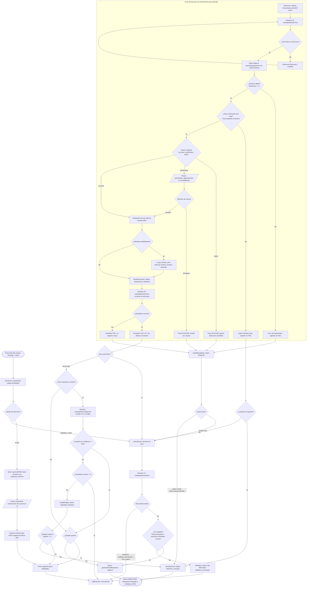

# Flujo principal

> Última revisión: **2026-10-11**

Cuando el usuario envía una instrucción y elige un modo (`NORMAL` / FAST o `PLAN`) desde la interfaz web o mediante `POST /api/jarvis/process`, el orquestador autoritativo `JarvisCore` inicializa un contexto de tarea (`TaskExecutionContext`) con estado `RUNNING` y arranca la ejecución asíncrona. En modo **FAST**, el bucle `runFastLoop` evalúa de forma iterativa el enrutamiento con Decision #1 (sub-sistemas `windows`, `desktop_commander`, `free_search` o `fin`), selecciona la herramienta óptima con Decision #2, genera parámetros validados mediante Qwen 3.5 9B, somete la acción a las compuertas de Anti-Loop y Guard (solicitando aprobación interactiva en `GuardBanner` si muta el sistema), ejecuta la llamada vía stdio en el servidor MCP correspondiente, procesa evidencias en `ResultProcessor` y evalúa el éxito con Decision #5 (activando escalación si falla). En modo **PLAN**, `initiatePlanMode` solicita a Qwen un plan estructurado de hasta 15 pasos con criterios observables (`expected_outcome`), pausa la ejecución hasta recibir confirmación explícita del usuario (`POST /api/jarvis/confirm-plan`) y ejecuta cada paso en `runPlanLoop` verificando su cumplimiento con `evaluatePlanJudgement` y activando replanificaciones automáticas (`handleReplan`) ante incidencias.

## Diagrama del flujo



## Pasos

Secuencia ordenada de ejecución desde la recepción de la instrucción hasta la entrega de la respuesta final:

| # | Paso | Descripción | Código |
|---|------|-------------|--------|
| 1 | Recepción e inicio de tarea | Se recibe el mensaje y modo, se genera un ID único, se crea `TaskExecutionContext` en estado `RUNNING` y se emite el evento `TASK_CREATED` | `src/core/core.ts:initiateTask()` |
| 2 | Enrutamiento estructural (Decision #1) | Decision 2.0 evalúa la meta, historial colapsado y acciones previas para determinar la ruta (`windows`, `desktop_commander`, `free_search` o `fin`) | `src/core/decision.ts:evaluateDecisionOne()` |
| 3 | Verificación de fin / conversación directa | Si D1 elige `fin` en la primera iteración o tras herramientas previas verificadas, se concluye la tarea; si no cumple criterios, se redirige a `desktop_commander` | `src/core/modeEngines.ts:runFastLoop()` |
| 4 | Descubrimiento de herramientas | Se consultan las herramientas del servidor MCP seleccionado desde el caché de Discovery o llamando a `tools/list` mediante stdio | `src/core/mcp/discovery.ts:getDiscoveredTools()` |
| 5 | Selección de herramienta (Decision #2) | Decision 2.0 selecciona la herramienta específica dentro de las 2-255 herramientas descubiertas, marcando advertencias anti-repetición | `src/core/decision.ts:evaluateDecisionTwo()` |
| 6 | Generación de argumentos (Qwen Etapa 3) | Qwen 3.5 9B genera los parámetros JSON conforme al esquema de entrada limpio (`cleanedSchema`), aplicando hasta 2 reintentos ante error de schema | `src/core/reasoner/qwen.ts:generateArguments()` |
| 7 | Verificación Anti-Loop | Se verifica la firma `mcp:tool:args:mCounter` impidiendo ejecutar acciones idénticas consecutivas sin lectura intermedia | `src/core/callExecutor.ts:executeCall()` |
| 8 | Evaluación de seguridad (Guard) | Guard evalúa las políticas deterministas: autoriza lecturas seguras (`ALLOW`), bloquea patrones raíz (`DENY`) o exige aprobación (`APPROVAL`) | `src/core/policy/guard.ts:evaluate()` |
| 9 | Compuerta de aprobación interactiva | Si Guard dictamina `APPROVAL`, el paso pasa a `WAITING_APPROVAL` y emite `APPROVAL_REQUESTED` hasta que el usuario resuelva en la UI | `src/core/callExecutor.ts:requestUserApproval()` |
| 10 | Despacho al servidor MCP | Se transmite la solicitud JSON-RPC 2.0 `tools/call` al proceso hijo correspondiente a través del transporte stdio persistente | `src/core/mcp/transport.ts:callTool()` |
| 11 | Recuperación de stale element en Windows | Si el servidor Windows retorna `staleElement: true`, se consulta el árbol de ventanas para refrescar el `window_handle` y se reintenta una vez | `src/core/callExecutor.ts:executeCall()` |
| 12 | Procesamiento de resultados y aislamiento | `ResultProcessor` extrae el hallazgo sintético, calcula señales (`exit_code`, `not_found`, etc.), guarda el texto en `RefStore` y actualiza hechos | `src/core/processor/resultProcessor.ts:process()` |
| 13 | Evaluación de resultado (Decision #5) | Decision 2.0 evalúa si el resultado aporta lo requerido por el objetivo (`correcta` vs `incorrecta`) con regla de override ante exit_code 0 | `src/core/decision.ts:evaluateDecisionFive()` |
| 14 | Actualización de memoria y auditoría | Se registra la línea en `task.memory.log` (`ok`, `err`, `nf`, `unv`), se graba el objeto `StepCall` y se emite `STEP_COMPLETED` | `src/core/callExecutor.ts:executeCall()` |
| 15 | Escalación o Replanificación | Si la acción falló, en modo FAST se activa la Etapa 5B con Qwen para cambiar de MCP o abortar; en modo PLAN se reformulan los pasos restantes | `src/core/modeEngines.ts:handleEscalation()` / `handleReplan()` |
| 16 | Síntesis de respuesta final (Qwen Etapa 6) | Qwen genera la respuesta final basada estrictamente en LOG, FACTS y EVID; se limpian las referencias de la tarea en `RefStore` | `src/core/modeEngines.ts:concludeTask()` |

## Decisiones

Puntos donde el flujo se bifurca y el criterio técnico exacto utilizado en el código:

- **Modo NORMAL vs PLAN (`src/core/core.ts:runTaskPipeline`):** Si `task.mode === "PLAN"`, se invoca `initiatePlanMode` (genera el plan y se detiene hasta confirmación del usuario); si `mode === "NORMAL"`, se arranca directamente `runFastLoop`.
- **Enrutamiento Decision #1 (`src/core/decision.ts:evaluateDecisionOne`):**
  - Si la opción elegida es `fin`: se valida contra el umbral de confianza (`0.51` normal, `0.60` si `nonReadCounter > 0`). Si no alcanza el umbral, se rechaza `fin` y se adopta la ruta no-fin con mayor probabilidad (`desktop_commander`).
  - Si `fin` es validado: en la primera iteración se asume conversación directa y se responde sin tools; en iteraciones posteriores, se exige que exista al menos una acción exitosa previa y ninguna acción `UNVERIFIED` pendiente. Si no cumple, se redirige forzadamente a `desktop_commander`.
- **Evaluación de seguridad Guard (`src/core/policy/guard.ts:evaluate`):**
  - `DENY`: patrones destructivos prohibidos sobre el sistema raíz (`rm -rf /`, `format c:`, etc.) o inyecciones de comandos en terminal; la acción se aborta de inmediato con estado `BLOCKED` y señal `denied: true`.
  - `APPROVAL`: comandos de terminal no seguros, mutación o eliminación de archivos, control de procesos o descargas externas; se emite `APPROVAL_REQUESTED` y la ejecución se suspende hasta la resolución del usuario.
  - `ALLOW`: operaciones catalogadas como `READ` o comandos de terminal validados como inspección segura en `isSafeReadonlyCommand` (`dir`, `ls`, `type`, `cat`, `git status`, etc.); se despachan automáticamente.
- **Protección Anti-Loop (`src/core/callExecutor.ts:executeCall`):**
  - Si la firma `${serverName}:${tool}:${args}:m${nonReadCounter}` ya fue ejecutada sin una lectura intermedia, se devuelve `status: "blocked_loop"`.
  - Exenciones de polling: las herramientas `read_process_output` y `ui_wait` están explícitamente exentas de la verificación anti-loop (`isExempt`) para permitir sondeos continuos de procesos o esperas de cambios en la interfaz.
  - Si se acumulan 2 bloqueos consecutivos (`consecutiveLoopBlocks >= 2`), se detiene la tarea en estado `PARTIAL`.
- **Evaluación de resultado Decision #5 (`src/core/decision.ts:evaluateDecisionFive`):**
  - `correcta`: el paso concluye con éxito (`COMPLETED`) o queda en `UNVERIFIED` si fue una acción de interfaz despachada sin comprobación observable.
  - `incorrecta`: se añade la entrada a `task.memory.fail` y se activa el proceso de escalación (Etapa 5B).
  - Regla de override: si la confianza de D5 es inferior a `0.50` (`DECISION_OVERRIDE_CONFIDENCE_THRESHOLD`), `exit_code == 0` y no hay señales de error (`not_found`, `denied`, `empty_output`), se fuerza el resultado a `correcta`.
- **Acción de escalación Etapa 5B (`src/core/modeEngines.ts:handleEscalation`):**
  - `switch_mcp`: Qwen designa un nuevo subsistema MCP (`windows`, `desktop_commander` o `free_search`) que se fija en `activeServerOverride` y excluye la tool previa si se mantiene el mismo MCP.
  - `abort`: Qwen determina que la meta es inalcanzable; la tarea concluye con estado `PARTIAL` (si hubo pasos previos completados) o `FAILED`.
- **Juicio de criterio en modo PLAN (`src/core/modeEngines.ts:runPlanLoop`):**
  - Si el paso define `expectedOutcome`, se invoca `evaluatePlanJudgement`. Si el modelo responde `cumple` con confianza >= `0.60`, el paso se da por completado; si no, se permite hasta 4 llamadas (`MAX_TOOL_CALLS_PER_STEP`) antes de forzar un `handleReplan`.

## Iteraciones

Límites globales del bucle y condiciones deterministas de parada:

- **Máx. pasos por tarea (`MAX_STEPS`):** `15` pasos (en modo FAST detiene la tarea en `PARTIAL`; en modo PLAN limita la cantidad de pasos generados).
- **Máx. llamadas por paso en PLAN (`MAX_TOOL_CALLS_PER_STEP`):** `4` llamadas.
- **Tope global de llamadas por tarea (`MAX_TOOL_CALLS_TASK`):** `30` llamadas acumuladas (si se alcanza, detiene la tarea en `PARTIAL`).
- **Máx. reintentos de schema de argumentos (`MAX_ARG_RETRIES`):** `2` reintentos.
- **Máx. escalaciones por tarea (`MAX_ESCALATIONS`):** `2` escalaciones.
- **Máx. replanificaciones en modo PLAN (`MAX_REPLAN`):** `2` replanes.
- **Condiciones de parada:**
  1. `COMPLETED`: cuando Decision #1 elige `fin` validado (en FAST) o cuando se completan todos los pasos del plan cumpliendo sus criterios (en PLAN).
  2. `PARTIAL`: parada controlada cuando se alcanza `MAX_STEPS`, `MAX_TOOL_CALLS_TASK`, el tope de escalaciones o replanes, o tras 2 bloqueos seguidos de anti-loop, habiendo completado al menos un paso previo.
  3. `FAILED`: fallo irrecuperable en generación de plan inicial, aborto decidido en escalación sin pasos previos completados, o excepción no recuperable.
  4. `CANCELLED`: el usuario cancela la tarea activamente desde la UI (`POST /api/jarvis/cancel`).

## Manejo de errores

Tipos de error y respuesta técnica del sistema en cada caso:

| Error | Respuesta del sistema |
|-------|----------------------|
| Argumentos no cumplen el schema | Se reintenta hasta 2 veces (`MAX_ARG_RETRIES`) enviando el error en `ERROR_PREVIO`; si se agotan, se registra en FAIL y el paso falla como `logical_error` |
| Herramienta desconocida en Discovery | Se invalida el caché forzando re-descubrimiento en el servidor MCP; si sigue sin existir, la ejecución se interrumpe lanzando error fatal |
| Rechazo de seguridad Guard (`DENY`) | Se marca el paso como `BLOCKED`, se registra en FAIL como `DENY` y se devuelve `signals.denied = true` activando escalación |
| Operación rechazada por el usuario | Se marca el paso como `BLOCKED`, se registra `${tool} -> RECHAZADO por usuario` en FAIL y se activa la escalación para buscar alternativa |
| Invocación repetida (Anti-loop) | Se bloquea la ejecución retornando `status: "blocked_loop"`; si ocurren 2 bloqueos consecutivos, la tarea se detiene controladamente en `PARTIAL` |
| Stale element en Windows MCP | Se captura la señal `staleElement: true`, se consulta el árbol de ventanas mediante herramienta de UI para actualizar `window_handle` y se reintenta la llamada |
| Timeout en proceso MCP stdio | Se rechaza la promesa con `MCPTransportError` tras 30 s (`mcpTimeoutMs`); si el proceso hijo cae, se limpian peticiones pendientes |
| Proceso MCP termina inesperadamente | Se registra el último bloque de stderr (`getLastStderr`), se limpia el estado de transporte y se marca el servidor como no disponible en `unavailableServers` |
| Servicio Decision 2.0 inaccesible | Se lanza `DecisionServiceUnavailableError`. En Decision #5 se aplica fallback determinista a `correcta` si `exit_code == 0` y no hay señales de error; en D1 o D2 detiene el paso |
| Servicio Qwen inaccesible o timeout | Se lanza `LLMServiceUnavailableError` tras 60 s (`qwenTimeoutMs`); al concluir la tarea se aplica una respuesta sintética estructurada |
| Paso fallido en modo PLAN | Si el paso no cumple su `expected_outcome` tras 4 llamadas, se invoca `handleReplan` para que Qwen sustituya los pasos pendientes (hasta 2 replanes) |

## Ejemplo de traza

Caso real de punta a punta: el usuario solicita `"Busca en la web la versión actual de Node.js y guárdala en un archivo version.txt"` en modo `NORMAL`.

```
1. Usuario envía instrucción: "Busca en la web la versión actual de Node.js y guárdala en un archivo version.txt" (Modo: NORMAL)
→ Core crea tarea (id: task_174000_a1b2, state: RUNNING), emite TASK_CREATED.
→ Decision #1 (evaluación inicial):
  - state: Meta actual, historial vacío, sin intentos previos.
  - questions: route (choice: windows, desktop_commander, free_search, fin), needs_context (noul).
  - Decision 2.0 responde: route="free_search" (confianza: 0.88), needs_context=0.05.
→ Paso s1 creado (route: free_search).
→ Discovery: lista herramientas de free_search (search, fetch, read_doc...).
→ Decision #2:
  - state: Instrucción del paso, contexto de scratchpad.
  - questions: selected_tool (choice entre tools de free_search).
  - Decision 2.0 responde: selected_tool="search" (confianza: 0.94).
→ Qwen Etapa 3 (generación de argumentos):
  - Input: SCHEMA de search {query: string, max_results?: number}.
  - Output JSON: {"query": "Node.js current latest version", "max_results": 5}.
→ Anti-loop: primera llamada, pasa validación.
→ Guard: evalúa free_search:search -> capacidad READ -> decide ALLOW (automático).
→ Despacho MCP stdio: envía JSON-RPC tools/call a free-search-mcp.
→ Resultado MCP recibido: 5 resultados web devueltos en formato Markdown.
→ ResultProcessor:
  - Extrae URL principal (https://nodejs.org) y candidatos.
  - Almacena el texto completo en RefStore (ref: r1).
  - finding: "5 resultados web, primero: Node.js" (sanitizado a una línea).
  - compactObs: top 5 resultados recortados (780 chars).
  - signals: exit_code=0, sin errores técnicos.
→ Decision #5:
  - questions: evaluation ("¿El resultado aporta lo que pide el objetivo?").
  - Decision 2.0 responde: choice="correcta" (confianza: 0.91).
→ Memoria: añade línea a LOG "1|search|ok|5 resultados web, primero: Node.js". FACTS: url=https://nodejs.org.
→ Paso s1 COMPLETED.

2. Siguiente iteración en runFastLoop:
→ Decision #1 (segunda iteración):
  - state: Meta, LOG con paso s1 ok, intentos previos: [free_search/search: ok], último resultado.
  - Decision 2.0 responde: route="desktop_commander" (confianza: 0.82).
→ Paso s2 creado (route: desktop_commander).
→ Discovery: lista herramientas de desktop_commander (read_file, write_file, run_command...).
→ Decision #2:
  - Decision 2.0 responde: selected_tool="write_file" (confianza: 0.92).
→ Qwen Etapa 3 (generación de argumentos):
  - Input: SCHEMA de write_file {path: string, content: string}, FACTS con datos de Node.js.
  - Output JSON: {"path": "version.txt", "content": "Node.js versión actual: v22.14.0 LTS"}.
→ Anti-loop: acción no ejecutada previamente, pasa validación.
→ Guard: evalúa desktop_commander:write_file -> capacidad FILE_WRITE -> decide APPROVAL.
→ Paso s2 pasa a WAITING_APPROVAL. Emite APPROVAL_REQUESTED.
→ GuardBanner se despliega en UI: "Modificación o creación de archivo en la ruta 'version.txt'".
→ Usuario hace clic en "Autorizar" -> POST /api/jarvis/approve.
→ Paso s2 vuelve a RUNNING. Emite APPROVAL_RESOLVED.
→ Despacho MCP stdio: envía tools/call a desktop-commander.
→ Resultado MCP recibido: archivo creado satisfactoriamente.
→ ResultProcessor: finding: "Archivo version.txt escrito correctamente". RefStore: r2.
→ Decision #5: evalúa evaluation -> "correcta" (confianza: 0.95).
→ Memoria: añade línea a LOG "2|write_file|ok|Archivo version.txt escrito". FACTS: path=version.txt.
→ Paso s2 COMPLETED.

3. Siguiente iteración en runFastLoop:
→ Decision #1 (tercera iteración):
  - state: Meta, 2 pasos completados satisfactoriamente, acciones previas ok.
  - Decision 2.0 responde: route="fin" (confianza: 0.87 > 0.60 umbral post-acción).
→ Verificación de fin: validado (hubo acciones previas exitosas y ninguna UNVERIFIED).
→ Qwen Etapa 6 (concludeTask):
  - Input: GOAL, LOG de pasos 1 y 2, FACTS, EVID de las llamadas.
  - Output en español: "He consultado la web y guardado la información en el archivo version.txt. La versión actual de Node.js es la v22.14.0 LTS."
→ RefStore.clear(task_174000_a1b2): libera memoria de la tarea.
→ Tarea state pasa a COMPLETED. Se emiten FINAL_RESPONSE y TASK_STATE_CHANGED.
```

## Archivos relacionados

| Ruta | Rol |
|------|-----|
| `src/core/core.ts` | Orquestador principal `JarvisCore`, iniciación de tareas, persistencia y despacho de eventos reactivos |
| `src/core/modeEngines.ts` | Implementación del bucle directo FAST (`runFastLoop`), planificación (`runPlanLoop`), escalación y replan |
| `src/core/callExecutor.ts` | Ciclo de ejecución de herramienta (`executeCall`), compuerta Guard y verificación anti-loop |
| `src/core/decision.ts` | Evaluaciones de enrutamiento (D1), selección de tool (D2), éxito (D5) y juicio de plan en Decision 2.0 |
| `src/core/reasoner/qwen.ts` | Generación de argumentos con JSON schema, análisis de escalación (5B) y síntesis de respuesta final (6) |
| `src/core/policy/guard.ts` | Motor de compuerta de seguridad, detección de comandos seguros y reglas de autorización humana |
| `src/core/processor/resultProcessor.ts` | Procesamiento determinista de respuestas MCP, cálculo de señales y almacén `RefStore` |