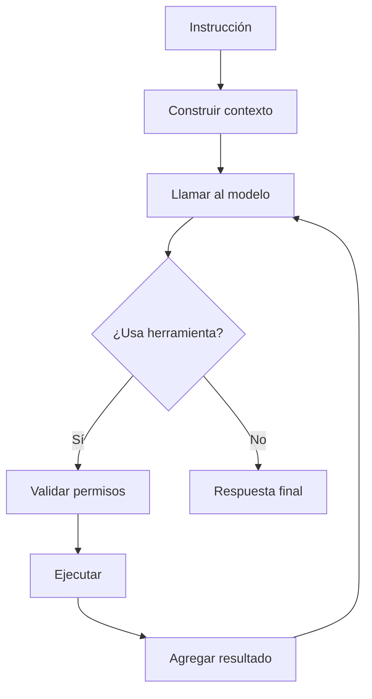

# Flujo principal

> Última revisión: **[COMPLETAR: AAAA-MM-DD]**

> **[COMPLETAR]** Resumen: qué ocurre desde que el usuario escribe hasta la respuesta final.

## Diagrama del flujo

> **[COMPLETAR]** Flujo completo con decisiones y bucles.



## Pasos

> **[COMPLETAR]** Un paso por fila, en orden, con el archivo/función responsable.

| # | Paso | Descripción | Código |
|---|------|-------------|--------|
| 1 | *Ej: Recepción* | *Se recibe y normaliza la instrucción* | `agent.ts:run()` |
| 2 | *Ej: Contexto* | *Se arma prompt + historial + memoria* | `context/builder.ts` |
| 3 | *Ej: Decisión* | *El modelo responde o pide una tool* | `agent.ts:step()` |
| 4 | *Ej: Ejecución* | *Se ejecuta la tool aprobada* | `tools/executor.ts` |
| 5 | *Ej: Respuesta* | *Se entrega y se guarda en historial* | `agent.ts` |

## Decisiones

> **[COMPLETAR]** Puntos donde el flujo se bifurca y el criterio usado.

- *Ej: Si el modelo devuelve `tool_use` → se ejecuta; si devuelve texto → se termina.*

## Iteraciones

> **[COMPLETAR]** Cómo funciona el bucle y cuándo se detiene.

- **Máx. iteraciones:** *Ej: 10*
- **Condición de parada:** *Ej: respuesta sin tool calls, límite alcanzado o cancelación.*

## Manejo de errores

> **[COMPLETAR]** Tipos de error y qué hace JARVIS en cada caso.

| Error | Respuesta del sistema |
|-------|----------------------|
| *Ej: Tool falla* | *Se devuelve el error al modelo para que reintente o replanifique* |
| *Ej: Timeout del modelo* | *Reintento con backoff (máx. 3)* |
| *Ej: Permiso denegado* | *Se informa al modelo y al usuario* |

## Ejemplo de traza

> **[COMPLETAR]** Un caso real, de punta a punta.

```
Usuario: "Resume el archivo notes.txt"
→ Contexto armado (1.2k tokens)
→ Modelo: tool_use read_file(notes.txt)
→ Permiso: automático (solo lectura)
→ Resultado agregado al contexto
→ Modelo: respuesta final
```

## Archivos relacionados

> **[COMPLETAR]** Solo los 5-8 archivos clave (entry points, interfaces, config).

| Ruta | Rol |
|------|-----|
| *Ej: `src/core/agent.ts`* | *Orquestación del bucle* |
| *Ej: `src/tools/executor.ts`* | *Ejecución de tools* |