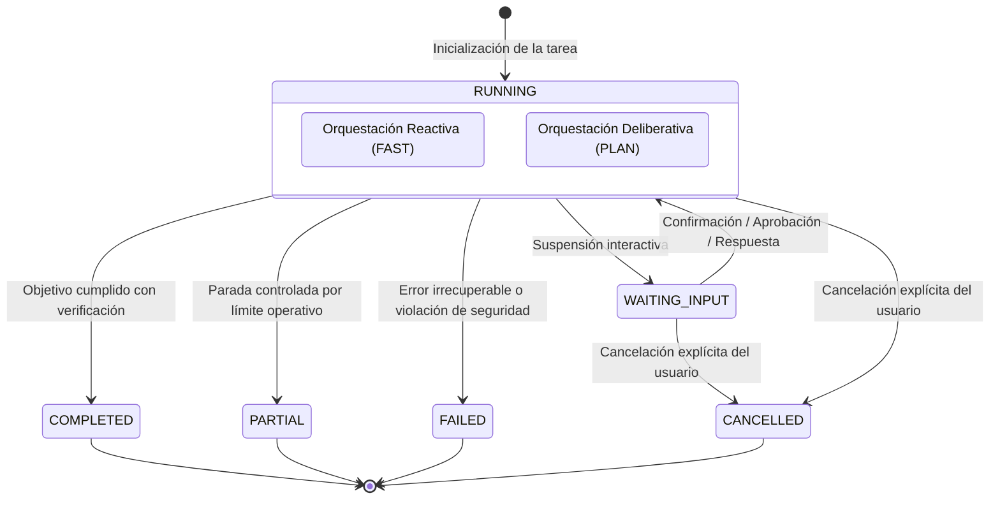
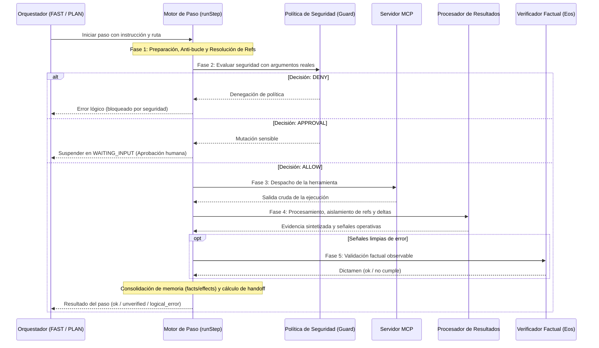

# Flujo de Ejecución y Orquestación

JARVIS Core implementa un modelo de ejecución determinista y resiliente para la resolución autónoma de tareas. Su arquitectura se fundamenta en un **motor atómico de ejecución de herramientas** sobre el cual operan dos estrategias de orquestación complementarias: una **reactiva (FAST)** para navegación directa y exploración continua, y una **deliberativa (PLAN)** para descomposición en etapas supervisadas y replanteamiento autónomo.

---

## 1. Propósito y Principios

El flujo de orquestación y ejecución persigue cuatro principios arquitectónicos:

1. **Motor de ejecución único e indivisible:** Toda interacción física con herramientas y servidores MCP se canaliza a través de un único pipeline determinista de ejecución, garantizando que las políticas de seguridad, anti-bucle, resolución de referencias y verificación factual se apliquen de forma homogénea sin importar la estrategia de orquestación utilizada.
2. **Determinismo y progresividad:** Las decisiones de alto nivel se apoyan en heurísticas y modelos especializados que delimitan el alcance de cada paso antes de emitir acciones sobre el entorno.
3. **Supervisión por capas:** Distinción explícita entre la verificación factual de una herramienta (si la invocación técnica cumplió su objetivo observable) y la verificación semántica de una etapa (si el resultado global acerca al sistema a la resolución de la tarea).
4. **Resiliencia y degradación no destructiva:** Las anomalías, ausencias temporales de modelos de verificación o bloqueos lógicos no provocan fallos catastróficos; el sistema degrada a estados no verificados o conclusiones parciales controladas, protegiendo las mutaciones ya consolidadas.

---

## 2. Ciclo de Vida y Estados Canónicos de la Tarea

Toda tarea procesada por el núcleo transita por una máquina de estados finita con garantías de persistencia y trazabilidad.



### Estados y Semántica Operativa

* **`RUNNING`:** Ejecución activa de una de las estrategias de orquestación.
* **`WAITING_INPUT`:** Ejecución suspendida temporalmente en espera de intervención humana. Existen exactamente tres causas canónicas de suspensión:
  1. `plan_confirmation`: El plan estructurado inicial requiere validación, ajuste o rechazo por parte del usuario antes de iniciar la ejecución de herramientas.
  2. `approval`: Una herramienta clasificada como mutación sensible o restringida por las políticas de seguridad requiere autorización explícita para ejecutarse.
  3. `user_answer`: El supervisor semántico determinó que falta información esencial del usuario que no puede obtenerse mediante herramientas autónomas.
* **`COMPLETED`:** La tarea alcanzó su objetivo satisfactoriamente con evidencia contrastada. El sistema genera una síntesis de cierre a partir de las observaciones acumuladas.
* **`PARTIAL`:** Conclusión controlada cuando se alcanza la cota operativa máxima de pasos o ante bloqueos repetidos de anti-bucle. Si se produjo trabajo útil previo, la tarea concluye como parcial en lugar de fallida, preservando los hallazgos y efectos generados.
* **`FAILED`:** Tarea abortada por un fallo terminal: denegación irremediable de políticas de seguridad, errores críticos e irrecuperables de infraestructura, o agotamiento de los intentos de replanificación sin resolución.
* **`CANCELLED`:** Interrupción inmediata provocada por el usuario. El sistema suspende el trabajo, descarta resultados en tránsito y libera los recursos en memoria.

---

## 3. Dualidad de Orquestación sobre Motor Unificado

La arquitectura no duplica la lógica de ejecución: **FAST** y **PLAN** son dos modos de orquestación que comparten y alimentan al mismo motor indivisible de paso (`runStep`).

```
                ┌──────────────────────────────────────────────┐
                │             JarvisCore (Entrada)             │
                └──────────────────────┬───────────────────────┘
                                       │
                 ┌─────────────────────┴─────────────────────┐
                 ▼                                           ▼
       ┌──────────────────┐                        ┌──────────────────┐
       │ Modo FAST        │                        │ Modo PLAN        │
       │ (Reactivo)       │                        │ (Deliberativo)   │
       │                  │                        │                  │
       │ • Arbitraje D1/D2│                        │ • Plan previo    │
       │ • Paso a paso    │                        │ • Supervisión Qwen│
       │ • Salida directa │                        │ • Replan local   │
       └─────────┬────────┘                        └─────────┬────────┘
                 │                                           │
                 └─────────────────────┬─────────────────────┘
                                       ▼
                 ┌───────────────────────────────────────────┐
                 │       runStep() — Motor Atómico           │
                 │                                           │
                 │ 1. Descubrimiento y anti-bucle            │
                 │ 2. Argumentos y resolución de referencias │
                 │ 3. Evaluación de seguridad (Guard)        │
                 │ 4. Despacho MCP y procesamiento           │
                 │ 5. Verificación factual (Eos)             │
                 │ 6. Consolidación de memoria y handoff     │
                 └───────────────────────────────────────────┘
```

### A. Modo FAST (Orquestación Reactiva)
* **Filosofía:** Orientado a exploración rápida, consultas informativas y tareas directas sin dependencias complejas entre etapas.
* **Mecánica:**
  * En cada iteración, un selector de ruta evalúa el historial acumulado y decide si continuar explorando una ruta temática o concluir (`fin`).
  * La compuerta de conclusión exige que haya existido al menos una acción útil previa o que la solicitud sea conversacional pura.
  * Si la herramienta produce errores lógicos recurrentes, el modo escala suspendiendo en espera de confirmación humana antes de insistir a ciegas.

### B. Modo PLAN (Orquestación Deliberativa y Supervisada)
* **Filosofía:** Orientado a metas complejas que requieren orden predecible, validación previa y supervisión de hitos.
* **Mecánica:**
  * **Planificación inicial:** Un modelo razonador descompone la solicitud en una secuencia estructurada de etapas con criterios observables de éxito. Si la configuración lo exige, el plan se suspende en `WAITING_INPUT` para confirmación o modificación humana.
  * **Ejecución secuencial:** Cada etapa se envía al motor unificado `runStep`.
  * **Doble verificación:** Tras la verificación factual técnica del motor (`runStep`), un supervisor semántico evalúa si la evidencia obtenida realmente cumple el objetivo global de la etapa.
  * **Veredictos semánticos:**
    - *Completado:* La etapa alcanzó su criterio observable y se avanza a la siguiente.
    - *Desviación recuperable:* La herramienta corrió limpiamente pero no alcanzó el objetivo; se activa la replanificación autónoma.
    - *Información insuficiente:* Falta información que solo el usuario posee; el sistema suspende en `WAITING_INPUT` y reanuda tras recibir la respuesta.
    - *Bloqueo irrecuperable:* La meta es inviable o contradictoria; la tarea concluye como fallida.
  * **Invariante de replanificación (`replan`):** Las etapas ya completadas **jamás se repiten**, y las mutaciones físicas consolidadas en el entorno se transmiten intactas al nuevo plan para formular alternativas sin re-ejecutar acciones destructivas. Solo se reestructuran las etapas pendientes.

---

## 4. Pipeline Atómico de Ejecución de un Paso (`runStep`)

Cada acción sobre el entorno atraviesa un pipeline riguroso y secuencial de cinco fases:



### Fases del Pipeline:
1. **Preparación y Anti-bucle:** Se descubren y validan las herramientas de la ruta. Se calcula una firma contextual que impide invocar herramientas idénticas con los mismos parámetros a menos que medien lecturas intermedias. Los tokens de referencia se resuelven deterministamente sustituyéndolos por sus datos íntegros antes del control de seguridad.
2. **Evaluación de Seguridad (Guard):** Se analizan los argumentos ya resueltos. Si la acción infringe una política estricta, se deniega (`DENY`); si implica una mutación sensible, la tarea se suspende en `WAITING_INPUT` solicitando aprobación; si está permitida (`ALLOW`), prosigue al despacho.
3. **Despacho y Aislamiento:** Invocación en el servidor MCP correspondiente bajo control de cancelación. Si la tarea fue cancelada mientras la herramienta ejecutaba, la respuesta tardía se descarta sin contaminar el estado.
4. **Procesamiento de Resultados:** El procesador segrega salidas masivas hacia el almacén de referencias, genera una observación compacta y extrae los deltas de estado.
5. **Verificación Factual y Consolidación:**
   * Las señales limpias se someten al modelo verificador.
   * **Garantía ante caída del verificador:** Si el modelo de verificación no responde, el paso **jamás se auto-aprueba**; se cataloga estrictamente como `UNVERIFIED`.
   * Los hechos (`facts`) solo se integran si el paso fue verificado o si describe una mutación física confirmada.
   * Se genera un descriptor determinista de enlace (*handoff*) para alimentar el contexto directo del siguiente paso.

---

## 5. Políticas de Resiliencia, Cancelación y Recuperación

### A. Cancelación Cooperativa Unificada (`AbortSignal`)
* Cada tarea cuenta con un único controlador de aborto que viaja por todas las capas: transporte HTTP hacia los modelos, esperas de autorización y llamadas a herramientas MCP.
* **Invariante de cancelación:** Una cancelación solicitada por el usuario nunca se interpreta ni se registra como error de red, fallo de infraestructura o error lógico. El sistema aborta silenciosamente las operaciones pendientes, descarta respuestas en vuelo y libera los recursos asociados.

### B. Degradación Controlada ante Incertidumbre (`UNVERIFIED`)
* Los pasos que no pudieron ser verificados por ausencia temporal del modelo verificador o por naturaleza no contrastable no bloquean inmediatamente la tarea ni se consideran fallos.
* Sin embargo, el sistema impone una compuerta: una tarea no puede declararse exitosamente concluida si persisten pasos no verificados que no hayan sido observados o consolidados por una lectura posterior.

### C. Recuperación ante Fallos de Inferencia
* **Nivel Transporte:** Respuestas transitorias de sobrecarga o fallos de conexión temporales aplican reintentos inmediatos con espera exponencial antes de reportar un fallo de infraestructura.
* **Nivel Validación de Salida:** Si la respuesta de un modelo de razonamiento no satisface el esquema estructurado esperado o sufre truncamiento por ventana de contexto, el sistema efectúa un reintento correctivo inyectando el motivo del fallo en el prompt para guiar la autocorrección del modelo.
