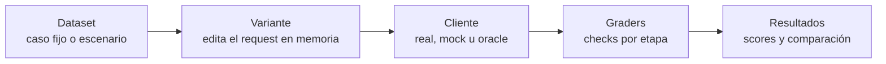

# Jarvis · Eval

> Mide cómo decide y responde Jarvis, y valida cada cambio de prompt contra producción antes de tocar `src`.

**Versión 1.0** · Evalúa las ocho etapas del flujo, compara variantes de prompt y modelos, y deja cada resultado trazable.

---

## Qué ofrece

| | |
|---|---|
| **Contexto real de Jarvis** | Los casos por escenario describen la situación y el eval arma el prompt con el mismo código que usa Jarvis: vistas, mensajes fijos, renderizadores y parámetros de cada etapa. Si `src` cambia, el eval se actualiza solo. |
| **Cobertura completa** | Cuatro etapas de decisión y cuatro generativas, cada una con graders propios: etiqueta y probabilidad en las decisiones; estructura y contenido en las salidas generativas. |
| **A/B de prompts sin riesgo** | Las variantes se aplican en memoria y se comparan contra la baseline `prod`: deltas, regresiones y mejoras caso por caso, prueba de signos y promedio por etapa. No modifica `src` ni los casos. |
| **Lectura por tipo de modelo** | El resumen separa etapas generativas y de decisión, y avisa cuando una variante mejora un tipo y empeora el otro, para que el total no engañe. |
| **Comparación de modelos** | Un mismo dataset contra varios modelos generativos, de decisión o configuraciones completas, con deltas contra una referencia. |
| **Fiel a producción** | Mismos reintentos, mismos criterios de validación y un `pass` estricto: un run solo pasa si no registra ningún error. |
| **Verificable sin GPU** | El cliente `oracle` responde lo que pide cada caso y debe dar 100 %: si falla, el problema no es el modelo. `mock` y `--dry-run` prueban la maquinaria sin red. |
| **Trazable** | Cada celda guarda cada ejecución, sus métricas y su configuración: commit, hashes de dataset y variante, filtros y casos corridos. |
| **Listo para CI** | `--min-pass-rate` y códigos de salida definidos. También incluye un asistente interactivo (`--menu`). |

---

## Inicio rápido

Desde la raíz del repo, con [Ollama](https://ollama.com) activo para las corridas reales:

```bash
npm run eval -- --list
npm run eval -- --menu
npm run eval -- --client=oracle --dataset=smoke
npm run eval -- --dataset=smoke
npm run eval -- --variant=prod,mi_variante --dataset=smoke --repeat=3
```

| Comando | Qué hace |
|---|---|
| `--list` | Lista etapas, variantes y datasets disponibles |
| `--menu` | Asistente interactivo que arma y ejecuta el comando |
| `--client=oracle` | Valida casos y graders sin modelos |
| `--dataset=smoke` | Corrida real con los modelos de producción (por defecto `qwen3.5:4b` y `d3:2b`) |
| `--variant=… --repeat=3` | Compara una variante contra `prod` con tres repeticiones |

---

## Cómo funciona



Cada corrida ejecuta **variante × dataset × caso × repetición** y guarda el resultado en `eval/results/`:

```
eval/results/<modelo>/<fecha>/
├── comparison.md                  reporte para leer
├── comparison.json
└── <variante>__<dataset>/
    ├── runs.jsonl                 cada ejecución: request, salida, errores, latencia, tokens
    ├── scores.json                métricas agregadas
    └── meta.json                  configuración, commit, hashes, filtros y casos
```

---

## Documentación

Toda la referencia está en [`INSTRUCCIONES.md`](./INSTRUCCIONES.md): flags, formato de casos y escenarios, cómo escribir variantes, comparación de modelos, estructura de resultados, interpretación de métricas y estructura del código.
