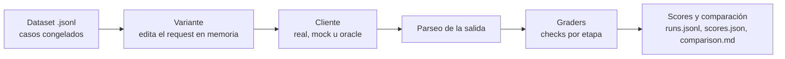

# Jarvis · Eval de prompts

Laboratorio para medir prompts y modelos de Jarvis contra casos congelados, y para comparar una variante de prompt con producción antes de tocar `src`.

- **Mide** cada etapa del flujo con graders específicos: etiqueta correcta en las decisiones, y estructura y contenido en las salidas generativas.
- **Compara** variantes de prompt contra la baseline `prod`, con deltas, regresiones y mejoras por caso.
- **No toca nada**: ni `src` ni los casos. Las variantes se aplican en memoria, solo durante la corrida.

> Referencia completa de flags, formatos y códigos de salida: [`INSTRUCCIONES.md`](./INSTRUCCIONES.md).

---

## Inicio rápido

Desde la raíz del repo:

```bash
npm run eval -- --list
```

```bash
npm run eval:smoke
```

```bash
npm run eval -- --client=oracle --dataset=eval/prompts/datasets/smoke.jsonl
```

```bash
npm run eval -- --dataset=eval/prompts/datasets/smoke.jsonl
```

| Comando | Qué hace | Necesita Ollama |
|---|---|:---:|
| `--list` | Lista etapas, variantes y datasets | No |
| `eval:smoke` | Imprime los requests que se enviarían (`--dry-run`) | No |
| `--client=oracle` | Responde lo que pide cada caso. **Debe dar 100 %** | No |
| (sin `--client`) | Corrida real contra `qwen3.5:4b` y `d3:2b` | Sí |

Por defecto usa Ollama en `http://127.0.0.1:11434` con `qwen3.5:4b` para las etapas generativas y `d3:2b` para las de decisión.

---

## Cómo funciona



Cada corrida ejecuta **variante × dataset × caso × repetición**. Un run pasa solo si no registra ningún error: llamada al modelo, aplicación de la variante, parseo y todos los checks de los graders.

### Etapas

| Tipo | Etapa | Qué se evalúa |
|---|---|---|
| Decisión (`d3`) | `route` | Ruta elegida (`files`, `web`, `fin`, `ask_user`…) y su probabilidad |
| Decisión (`d3`) | `tool_choice` | Herramienta elegida o `ask_user` |
| Decisión (`d3`) | `args_review` | `approved`, `args_invalid`, `tool_rejected` o `info_missing` |
| Decisión (`d3`) | `result_verification` | Veredictos `ok` y `cumple` |
| Generativa | `plan` | Cantidad de pasos, rutas permitidas y requeridas, palabras clave |
| Generativa | `arguments` | Campos requeridos, valores exactos, refs válidos, valores prohibidos |
| Generativa | `final` | Datos y efectos que debe mencionar, alucinaciones prohibidas |
| Generativa | `question` | Largo, una sola pregunta, sin fugas de identificadores internos |

### Reintentos iguales a producción

Las etapas generativas y el transporte reintentan como lo hace Jarvis, para que el pass rate sea comparable con el real:

- **Red o HTTP 503:** un reintento tras 1 s, en todas las etapas.
- **Salida inválida o truncada** (`plan`, `arguments`, `final`, `question`): un reintento con `ERROR_PREVIO`, 1.5× tokens y temperatura 0.3.

El run guarda `measurements.attempts` y un warning por cada reintento.

---

## Los tres clientes

| `--client` | Para qué sirve |
|---|---|
| `real` *(default)* | Llama a los modelos. Es la única forma de medir prompts |
| `oracle` | Lee el `expect` del caso y responde lo correcto. Valida casos, graders y parseo: si falla, el problema **no** es el modelo |
| `mock` | Respuestas genéricas sin red. Solo prueba la maquinaria |

El oráculo solo entiende la variante `prod` (no interpreta `labelMap` ni `answerMap`).

---

## Escribir un caso

Un caso es una línea de un `.jsonl` en `eval/prompts/datasets/`. Las líneas vacías y las que empiezan con `#` se ignoran.

```json
{"id":"smoke-route","stage":"route","tags":["smoke"],
 "request":{"type":"decision","state":"Request: list the files in the project",
   "questions":{"route":{"type":"choice","instructions":"Pick the next route.",
     "criteria":{"files":"Read or write files","web":"Browse the web","fin":"Task is done","ask_user":"Need more info"}}}},
 "expect":{"expectedAction":"route","expectedRoute":"files"}}
```

| Campo | Descripción |
|---|---|
| `id` | Único dentro del dataset |
| `stage` | Una de las ocho etapas |
| `request` | Lo que se envía al modelo: `decision` (`state` + `questions`) o `generative` (`system` + `user` + parámetros) |
| `expect` | Lo que debe cumplir la salida. Claves cerradas por etapa; un typo falla al cargar con `archivo:línea` |
| `tags`, `description` | Opcionales. Los tags sirven con `--tags=` |
| `isRaw` | Caso adversarial: se reporta aparte, fuera del pass rate canónico |
| `meta.toolSchema` | **Obligatorio en `arguments`**: schema real de la herramienta, para validar como prod |

Los casos de decisión con una sola opción (donde producción omitiría la llamada) se etiquetan solos como `prod_shortcut` y quedan fuera del pass rate salvo que uses `--include-shortcut`.

Hay dos datasets de ejemplo: `smoke.jsonl` (una pasada por todas las etapas) y `decision_discriminating.jsonl` (decisiones donde la respuesta correcta **no** es la primera opción, para detectar sesgo de posición).

---

## Escribir una variante

Una variante es un archivo en `eval/prompts/variants/<nombre>.ts` que edita el request en memoria. El `name` debe coincidir con el archivo, y `prod` es la identidad.

```ts
import type { Variant } from "../core/variants/types.ts";

const concise_plan: Variant = {
  name: "concise_plan",
  generative: {
    plan: {
      user: { append: "\n\nUse the fewest steps possible." },
      params: { temperature: 0.2 },
    },
  },
  decision: {
    route: {
      questions: {
        route: { instructions: { append: "\n\nPrefer web when the user asks to look something up." } },
      },
    },
  },
};

export default concise_plan;
```

Para decisiones también podés editar `state`, cambiar o quitar criterios (`criteria: { set, remove, append }`), reemplazar una pregunta y renombrar opciones con `labelMap`. Un ejemplo completo está en `variants/route_example.ts`.

Se corren y comparan así:

```bash
npm run eval -- --variant=prod,concise_plan --dataset=eval/prompts/datasets/smoke.jsonl
```

`prod` se incluye siempre como baseline. Se pueden combinar variantes con `+` (`--variant=varA+varB`).

---

## Leer los resultados

Cada corrida imprime la configuración, el progreso por caso y dos resúmenes:

```
── Resumen por variante ──
  Variante         passRate      Δ vs baseline  Regresiones  Mejoras  Fallas cliente  p50
  ---------------  ------------  -------------  -----------  -------  --------------  ---
  prod (baseline)  100.0% (9/9)  —              0            0        0               0ms
  route_example    100.0% (9/9)  0.0%           0            0        0               0ms
```

Todo queda guardado en `eval/prompts/results/<modelo>/<fecha>[_<label>]/`:

```
<corrida>/
├── comparison.md              ← el reporte para leer
├── comparison.json
└── <variante>__<dataset>/
    ├── runs.jsonl             ← un registro por ejecución: request, salida, errores, latencia, tokens
    ├── scores.json            ← métricas agregadas de la celda
    └── meta.json              ← configuración, commit de git, hashes de dataset y variante
```

`comparison.md` trae el resumen por variante, el detalle por etapa, los deltas contra la baseline, las regresiones y mejoras caso por caso, y las matrices de confusión de las decisiones.

### Códigos de salida

| Código | Significado |
|:---:|---|
| `0` | Correcto (y umbral cumplido, si se pidió `--min-pass-rate`) |
| `1` | Alguna celda quedó por debajo de `--min-pass-rate` |
| `2` | Error de configuración o dataset, filtros sin casos, o todas las llamadas fallaron por red, timeout o HTTP |

---

## Qué tener en cuenta al interpretar

- **Latencia y concurrencia.** Con `--concurrency` mayor que 1, p50 y p95 incluyen espera del servidor y no son comparables. Usá `1` para medir latencia; el pass/fail no se ve afectado.
- **Fallas de red.** Cuentan como falla en el pass rate, pero no entran en las latencias ni aparecen como regresión o mejora. La CLI avisa cuántas fueron.
- **Casos congelados.** Guardan el prompt tal como se extrajo. Si cambiás los prompts de producción, hay que volver a extraer los casos. El eval compara contra esa foto, no contra `src` en vivo.
- **Palabras clave.** Se buscan por palabra completa, sin distinguir mayúsculas ni acentos: "archivo" no coincide con "archivos". Escribí ambas formas si hacen falta.
- **Variantes con `labelMap`.** Dos opciones que se mapeen al mismo nombre canónico se pisan entre sí; evitalo.
- **Modelos.** Los pass rates valen solo para el modelo con el que corren. Los defaults coinciden con los de producción.

---

## Estructura del código

```
eval/
├── README.md
├── INSTRUCCIONES.md              referencia completa de flags
└── prompts/
    ├── cli.ts                    punto de entrada
    ├── datasets/                 casos congelados (.jsonl)
    ├── variants/                 variantes de prompt (prod, route_example)
    ├── results/                  salidas de cada corrida
    └── core/
        ├── runner.ts             ejecuta casos, reintentos, concurrencia
        ├── stages/               parseo y labels de cada etapa
        ├── graders/              checks por etapa
        ├── client/               real, mock y oracle
        ├── variants/             carga y aplicación de variantes
        ├── scoring.ts            métricas agregadas
        ├── report.ts             comparison.md y resumen en consola
        └── contract.ts           helpers de producción copiados (parseo, validación, límites)
```
