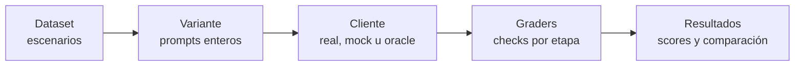

# Jarvis · Eval

> Mide cómo decide y responde Jarvis, y valida cada cambio de prompt contra producción antes de tocar `src`.

Evalúa las catorce etapas del flujo, compara variantes de prompt y deja cada resultado trazable.

---

## Qué ofrece

| | |
|---|---|
| **Contexto real de Jarvis** | Los casos por escenario describen la situación y el eval arma el prompt con el mismo código que usa Jarvis: vistas, mensajes fijos, renderizadores y parámetros de cada etapa. Si `src` cambia, el eval se actualiza solo. |
| **Cobertura completa** | Nueve etapas de decisión (`d0`, `route`, `tool_choice`, `args_review`, `result_verification`, `fragment_judge`, `d5`, `recovery` en modo sombra y `continuation`) y cinco generativas, cada una con graders propios: etiqueta y probabilidad en las decisiones; estructura y contenido en las salidas generativas. |
| **A/B de prompts sin riesgo** | Las variantes se aplican en memoria y se comparan contra la baseline `prod`: deltas, regresiones y mejoras caso por caso, prueba de signos y promedio por etapa. No modifica `src` ni los casos. Cada variante declara su `mode`: `prompt` (solo textos; las preguntas y opciones son las del backend y el eval lo verifica) es comparable contra `prod`; `structure` (cambia preguntas u opciones) se reporta aparte, sin deltas. |
| **Lectura por tipo de modelo** | El resumen separa etapas generativas y de decisión, y avisa cuando una variante mejora un tipo y empeora el otro, para que el total no engañe. |
| **Fiel a producción** | Mismos reintentos, mismos criterios de validación y un `pass` estricto: un run solo pasa si no registra ningún error. |
| **Verificable sin GPU** | El cliente `oracle` responde lo que pide cada caso y debe dar 100 %: si falla, el problema no es el modelo. `mock` y `--dry-run` prueban la maquinaria sin red. |
| **Trazable** | Cada celda guarda cada ejecución, sus métricas y su configuración: commit, hashes de dataset y variante, filtros y casos corridos. |
| **Listo para CI** | `--min-pass-rate` y códigos de salida definidos. También incluye un asistente interactivo (`--menu`). |

---

## Inicio rápido

Desde la raíz del repo, con [Ollama](https://ollama.com) activo para las corridas reales:

```bash
npm run eval -- --list
npm run eval -- --menu
npm run eval -- --client=oracle --dataset=smoke
npm run eval -- --dataset=smoke
npm run eval -- --variant=prod,mi_variante --dataset=smoke --repeat=3
npm run eval -- --variant=mi_variante --no-baseline --dataset=smoke   # sin prod como baseline
```

| Comando | Qué hace |
|---|---|
| `--list` | Lista etapas, variantes y datasets disponibles |
| `--menu` | Asistente interactivo que arma y ejecuta el comando |
| `--client=oracle` | Valida casos y graders sin modelos |
| `--dataset=smoke` | Corrida real con los modelos por defecto del eval (por defecto `qwen3.5:4b-text` y `d3:4b-text`; las URLs salen de ese archivo) |
| `--variant=… --repeat=3` | Compara una variante contra `prod` con tres repeticiones |

---

## Cómo funciona



Cada corrida ejecuta **variante × dataset × caso × repetición** y guarda el resultado en `eval/results/`:

```
eval/results/
├── evals/<modelo>/<YYYY-MM-DD_HHmmss>[_<label>]/     corridas manuales (npm run eval)
├── auto/<etapa>/<YYYY-MM-DD_HHmmss>/                 una sesión de --auto
│   ├── session.json                                  qué se pidió y cómo terminó (código de salida)
│   └── r0/  r1/  r2/ …  holdout-prod/  r1-holdout/   una carpeta por ronda (cada una es una corrida normal)
├── sin-modelo/<mock|oracle>/…                        corridas que no miden ningún modelo
└── herramientas/cross/…                              salidas de eval:cross

<carpeta de corrida>/
├── run.json                       qué se corrió: modelos, variantes, datasets, commit y resultado por celda
├── comparison.md                  reporte para leer
├── comparison.json
└── <variante>__<dataset>/
    ├── runs.jsonl                 cada ejecución: request, salida, errores, latencia, tokens
    ├── scores.json                métricas agregadas
    └── meta.json                  configuración, commit, hashes, filtros y casos
```

Una colisión en el mismo segundo agrega `-2`, `-3`. Las carpetas anteriores a esta estructura (`eval/results/<modelo>/…`) siguen siendo legibles y `--auto` las sigue reutilizando.

---

## Datasets y cruce con el pre-chequeo

Los datasets de `eval/datasets/<etapa>/` se mantienen directamente como archivos `.jsonl`. En `--auto`, sin `--dataset` ni `--holdout`: **desarrollo** = los de la etapa que no son holdout (los `*_hard_*` y los sueltos `<etapa>_<n>`), y **holdout** = los `<etapa>_holdout_<n>.jsonl` (los casos fáciles, que pasan todas las variantes). Una variante solo se acepta si supera a `prod` en desarrollo (además de llegar a `--target`) y en el holdout obtiene al menos lo de `prod` (`--holdout-margin` ajusta ese umbral; negativo tolera una caída pequeña). `npm run eval:psvalid` mide la validez PowerShell de los `command` de una corrida. `npm run eval:cross` mide el pre-chequeo determinista (`src/core/engine/precheck.ts`) sobre los casos `args_review` y lo cruza con los resultados de una corrida (falsos rechazos, recall por modo de falla, test pareado). `eval/datasets/smoke.jsonl` es el humo del arnés (un caso por etapa); los datasets de trabajo y los holdouts de cada etapa están en `eval/datasets/<etapa>/`.

## Mapa del código (para quien desarrolla el eval)

| Carpeta | Qué hay |
|---|---|
| `eval/core/` | El motor: casos y escenarios (`scenario.ts`, `case.ts`, `datasets.ts`), opciones del backend (`offered.ts`), etapas enchufables (`stages/`), graders, clientes (`client/`: real, mock, oracle), runner, scoring, reportes y variantes (`variants/`). |
| `eval/auto/` | El modo `--auto`. `loop.ts` orquesta; cada paso vive en su módulo: `initialRanking.ts` (Top-2 inicial), `round.ts` (una vuelta), `holdout.ts` (confirmación), `promptContext.ts` (lo que ve el optimizador), `batchExecution.ts` (lotes en worker), `runContext.ts` (contexto y memoria de la corrida). `eval/auto.ts` solo interpreta argumentos y corre una o varias etapas. |
| `eval/ui/` | Consola: asistente (`--menu`) y vistas. |
| `eval/exp/` | Análisis offline sobre resultados ya guardados (`d0_rules.ts`, `noul_cuts.ts`); no llaman a ningún modelo. |
| `eval/scripts/` | `run_all_decision.js`: corre cada etapa de decisión contra todas sus variantes, descubiertas por carpeta. |

## Agregar una etapa nueva (para quien desarrolla el eval)

Las etapas son enchufables y viven en `eval/core/stages/`. Para sumar una etapa nueva:
1. **Módulo de etapa (`eval/core/stages/<etapa>.ts`):** implementar `DecisionStageEntry` o `GenerativeStageEntry` con su `expectSpec` (claves, requeridas, enums y validación semántica), `buildRequest`, `parseOutput`, `label`, `graders`, `oracleAnswer` o `oracleOutput` y (en decisiones) `mainQuestionBindings`.
2. **Registro (`eval/core/stages/index.ts`):** importar la entrada y agregarla a `REGISTRY`.
3. **Tipos (`eval/core/types.ts`):** sumar el nombre a `DecisionStage` o `GenerativeStage` y definir `*Expect` y `*Output` (agregando `*Expect` a `StageExpect`).
4. **Contrato y graders (`eval/core/contract.ts`, `eval/core/graders/`):** reexportar constantes de `src/` si hacen falta y sumar un grader propio (p. ej. en `graders/label.ts`) si los existentes no cubren el `expect`.
5. **Caso de humo, dataset y variantes:** agregar un caso en `eval/datasets/smoke.jsonl`, datasets en `eval/datasets/<etapa>/` y variantes en `eval/variants/<etapa>/`.

---

## Documentación

**Si vas a tocar prompts, variantes o datasets de las etapas de decisión (`d0`, `route`, `tool_choice`, `args_review`, `result_verification`, `d5`, `recovery`), leé primero [`GUIA_DECISION.md`](./GUIA_DECISION.md)**: cómo funciona el modelo de decisión, qué no funcionó y cómo medir sin engañarte.

- [`INSTRUCCIONES.md`](./INSTRUCCIONES.md): comandos y flags, con ejemplos para tener a mano.
- [`REFERENCIA.md`](./REFERENCIA.md): etapas, formato de casos y escenarios, cómo escribir variantes, estructura de resultados, interpretación de métricas, cruce con el pre-chequeo y el modo `--auto`.
